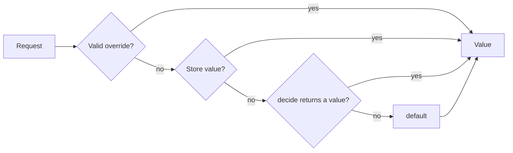

# Flargs Plan

Flargs is a self-hosted feature flag library for TypeScript and Rust. It declares flags in code, evaluates them on the server, and serves a dev route and an admin API from the host application. This plan defines the public API, the phases, and the acceptance gate of each phase.

## Motivation

Trunk-based development merges small changes to `main` often. Unfinished work ships to production, disabled behind a flag, and the flag controls the release. Coding agents make the extra work of small steps (flags, parallel configurations, staged migrations) almost free, so a flag must be cheap to add, read, and remove.

- **Short-lived branches:** a change merges when it is safe to deploy, not when the feature is complete.
- **Release without deploy:** an admin enables a flag in the admin UI. No new build is necessary.
- **Personal preview:** a developer enables a flag for one browser through the dev route or a link, and other users see no change.
- **Self-hosted:** flags live in the host application and its database. No third-party service, account, or toolbar is necessary.

## Reference: Vercel Flags SDK

The Vercel Flags SDK (`flags` on npm) is the reference design. Sources: https://vercel.com/docs/flags, https://flags-sdk.dev, read 2026-10-30.

| Concept            | Vercel Flags SDK                                                                | Flargs                                                                                |
| ------------------ | ------------------------------------------------------------------------------- | ------------------------------------------------------------------------------------- |
| Declaration        | `flag({ key, decide, defaultValue, options, identify })`, one callable per flag | `f.boolean`, `f.select`, `f.json` in one `Flags.define` record                        |
| Evaluation context | `identify({ headers, cookies })`, wrapped in `dedupe`                           | `identify(request)` on `Runtime.create`                                               |
| Value source       | `decide` or an adapter (Vercel Flags, Flagsmith, and others)                    | override, store value, `decide`, then `default`                                       |
| Overrides          | encrypted `vercel-flag-overrides` cookie, written by the Vercel Toolbar         | signed `flargs` cookie, written by the dev route, search parameters, or a signed link |
| Discovery          | `/.well-known/vercel/flags`, guarded by `verifyAccess`                          | the admin API under the dev route path, guarded by `authorize`                        |
| Admin UI           | Vercel dashboard and Flags Explorer                                             | the dev route, or a host UI on the admin API (for example, Tempo API Admin)           |
| Build-time values  | precompute: flag values encoded in the URL, with `generatePermutations`         | `build` flags compile to literals through `flargs/vite` or `Flags.defines`            |
| Client values      | `FlagValues` script tag, server-first                                           | `runtime.script` and `flags` from `flargs/values`, public flags only                  |
| Frameworks         | Next.js, SvelteKit                                                              | any fetch runtime (Next.js, Workers, Bun), Hono, Node, Vite, React, Rust              |

Flargs keeps these Vercel Flags SDK decisions:

- **Flags as code:** a flag is a typed declaration. Find All References locates every use.
- **Server-first:** the server evaluates flags. A client receives values, not rules.
- **One default:** the declaration holds the default, so every caller falls back to the same value.

Flargs changes these Vercel Flags SDK decisions:

- **Store in place of provider:** the store holds values that an admin sets. A `Store` is a small interface, so a host database implements it directly.
- **Dev route in place of toolbar:** the host serves its own page to toggle flags. Nothing loads from a third party.
- **Build flags in place of precompute:** a `build` flag removes dead code from the bundle and never reaches the API. Precompute of runtime flags is out of scope until a phase needs it.

## Concepts

### Resolution Time

| Time      | Resolves                                         | Overrides                                    | Reaches the client                                                        |
| --------- | ------------------------------------------------ | -------------------------------------------- | ------------------------------------------------------------------------- |
| `build`   | when the bundle is built, from `env` and `store` | dev mode only, through the dev server        | as a literal in the bundle, or through `runtime.script`, only if `public` |
| `runtime` | on the server for each request                   | dev mode, public flags, and signed overrides | through `runtime.script` or `Values.load`, only if `public`               |

A build flag never appears in the values endpoint or in the admin API write path. A bundler replaces each read with a literal, so dead branches drop from the bundle.

### Visibility

- **`private` (default):** the value stays on the server. Only the authorized admin API returns it.
- **`public`:** the values endpoint, `runtime.script`, and the bundle can contain the value. An unsigned override from a search parameter applies in production.

### Resolution Order



- **Override:** from the `flargs` cookie or the request search parameters. Search parameters take precedence over the cookie.
- **Store value:** set through the admin API or the CLI. It applies to every request.
- **`decide`:** code in the declaration, with the `identify` context. It returns `undefined` to fall through.
- **`default`:** required on every declaration.

An invalid override, store value, or `decide` result never selects a value. The server reports it through `onError` and continues with the next source.

### Overrides

| Mode              | Private runtime flag | Public runtime flag | Build flag                       |
| ----------------- | -------------------- | ------------------- | -------------------------------- |
| Dev (`dev: true`) | unsigned             | unsigned            | unsigned, through the dev server |
| Production        | signed only          | unsigned or signed  | rejected                         |

Search parameter format:

```txt
https://app.example.com/checkout?flag.newCheckout=true&flag.pricing=b
https://app.example.com/checkout?flag.newCheckout=true&flag.exp=1767225600&flag.sig=3q2-7w
https://app.example.com/?flag.reset
```

- `flag.<key>=<value>` sets one override. Booleans are `true` and `false`. Select values are option values. JSON values are URL-encoded JSON.
- `flag.exp` is the expiry in seconds since the epoch. `flag.sig` is a base64url HMAC-SHA256 over the canonical override string: the sorted `key=value` pairs and `exp`, joined with `&`.
- `flag.reset` clears every override.
- The server copies valid overrides from search parameters to the signed `flargs` cookie, so the overrides persist across navigation. The cookie is `HttpOnly`, `SameSite=Lax`, and `Secure` outside dev mode.

## Environment Variables

A flag reads an environment variable named `FEATURE_` followed by its key in `SCREAMING_SNAKE_CASE`. Environment variables alone configure an application with no `Runtime`, store, or admin API.

```bash
# .env
FEATURE_NEW_CHECKOUT=true
FEATURE_PRICING=b
FEATURE_LIMITS={"requests":100}
```

```ts
import { flags } from 'flargs/values'

// No Runtime and no Values.run: the value resolves from FEATURE_NEW_CHECKOUT, then the default.
flags.newCheckout
```

| Declaration | Variable value                |
| ----------- | ----------------------------- |
| `f.boolean` | `true` or `false`             |
| `f.select`  | one option value              |
| `f.json`    | JSON, validated by the schema |

- **Names:** `newCheckout` reads `FEATURE_NEW_CHECKOUT`. The `env` option of a declaration sets the variable name directly. `envPrefix` on `Runtime.create`, `flargs/vite`, and `#[flags(env_prefix)]` replaces `FEATURE_`.
- **Unrelated variables:** Flargs reads only the variables of declared flags. Another `FEATURE_*` variable has no effect.
- **Validation:** a value that fails validation throws at the first read, and the error names the variable. The error never contains the value.
- **Server:** outside `Values.run`, `flags` resolves each flag from its variable, then `default`.
- **Runtime:** `Store.env(env)` is a read-only store over the same variables. With `store: Store.env(process.env)`, overrides and `decide` still apply in the resolution order.
- **Browser:** `flargs/vite` replaces reads of public flags with the variable values. A private flag never reaches the bundle, whatever its variable. Visibility controls exposure, not the prefix, which differs from `VITE_` in Vite.
- **Library variables:** `FLARGS_SECRET`, `FLARGS_TOKEN`, and `FLARGS_URL` configure Flargs itself, so they keep the `FLARGS_` prefix.

A project can grow in three steps, with no change to its definitions or its reads of `flags`:

1. Environment variables, set for each deploy.
2. A `Runtime` with the dev route and personal overrides.
3. A shared store with an admin UI.

## Public API

### `flargs`

```ts
import { f, Flags } from 'flargs'

// Declare every flag of the application in one record. This module has no secrets, so the client and flargs/vite import it.
export const definitions = Flags.define({
  maintenanceBanner: f.boolean({
    default: false,
    description: 'Show the maintenance banner.',
    resolve: 'build',
    visibility: 'public',
  }),
  newCheckout: f.boolean({
    default: false,
    description: 'Use the new checkout flow.',
    visibility: 'public',
  }),
  pricing: f.select({
    default: 'a',
    description: 'Pricing page variant.',
    decide(context) {
      // Return undefined to fall through to the default.
      return context.user?.plan === 'enterprise' ? 'c' : undefined
    },
    options: ['a', 'b', 'c'],
  }),
})
```

`f` is the declaration namespace, in the style of `z` in Zod. `src/Flag.ts` holds the declarations, and `src/index.ts` exports the module as `f`.

| Export                                | Purpose                                                                        |
| ------------------------------------- | ------------------------------------------------------------------------------ |
| `f.boolean(options)`                  | declares a boolean flag                                                        |
| `f.select(options)`                   | declares a flag with a `const` tuple of `options`                              |
| `f.json(options)`                     | declares a flag with a JSON value, validated by a Standard Schema              |
| `Flags.define(record)`                | returns typed definitions, keyed by flag key                                   |
| `Flags.manifest(definitions)`         | returns the JSON manifest, the cross-language contract                         |
| `Flags.defines(definitions, options)` | returns `define` replacements for build flags, for any bundler                 |
| `Override.parse(input, options)`      | parses and verifies overrides from a `URL`, `URLSearchParams`, or cookie value |
| `Override.serialize(values, options)` | returns search parameters, signed when `secret` is set                         |
| `Override.InvalidSignatureError`      | thrown when a signature does not match or has expired                          |

`f.*` options:

| Option        | Type                                                             | Default                                          |
| ------------- | ---------------------------------------------------------------- | ------------------------------------------------ |
| `decide`      | `(context) => Value \| undefined \| Promise<Value \| undefined>` | none                                             |
| `default`     | `Value`                                                          | required                                         |
| `env`         | `string`, the environment variable name                          | `FEATURE_` and the key in `SCREAMING_SNAKE_CASE` |
| `description` | `string`                                                         | none                                             |
| `options`     | `readonly Value[]` for `select`                                  | required for `select`                            |
| `resolve`     | `'build' \| 'runtime'`                                           | `'runtime'`                                      |
| `schema`      | Standard Schema for `json`                                       | required for `json`                              |
| `visibility`  | `'private' \| 'public'`                                          | `'private'`                                      |

A build flag cannot declare `decide`. The type rejects it, since no request context exists at build time.

### `flargs/server`

`Runtime.create` returns the runtime instance of the flags. It holds the store, the secret, and `identify`. It listens on no port. Its `fetch` property is a fetch handler, as in Hono and Cloudflare Workers.

```ts
import { Runtime, Store } from 'flargs/server'
import { definitions } from './flags.js'

// One instance per application instance.
export const runtime = Runtime.create({
  authorize: (request) => Admin.verify(request),
  definitions,
  dev: process.env.NODE_ENV === 'development',
  identify: (request) => Session.user(request),
  path: '/.flags',
  secret: process.env.FLARGS_SECRET,
  store: Store.memory(),
})

// Evaluate one flag. The instance caches the result for this request.
const newCheckout = await runtime.get(request, 'newCheckout')

// Serve the dev route and the admin API.
const response = await runtime.fetch(request)
```

| Export                                | Purpose                                                                               |
| ------------------------------------- | ------------------------------------------------------------------------------------- |
| `Runtime.create(options)`             | returns `{ evaluate, fetch, get, script }`                                            |
| `runtime.evaluate(request, options?)` | returns every runtime value. `options.visibility: 'public'` returns public flags only |
| `runtime.fetch(request)`              | serves the dev route and the admin API, and returns `404` outside `path`              |
| `runtime.get(request, key)`           | returns one typed value, and runs `decide` for that flag only                         |
| `runtime.script(request)`             | returns a `<script>` element with public values, escaped with `safeJson`              |
| `Store.memory()`                      | in-memory store, for dev and tests                                                    |
| `Store.http(options)`                 | reads and writes a remote Flargs admin API, such as a central admin service           |
| `Store.kv(namespace)`                 | Cloudflare KV store                                                                   |
| `Store.env(env)`                      | read-only store over `FEATURE_*` variables                                            |
| `Store.from(store)`                   | types a host store, such as a Postgres table                                          |

`get` and `evaluate` cache results per `Request` object in a `WeakMap` that the instance owns. Several reads in one request run `identify`, the store read, and each `decide` once.

`Store` contract:

```ts
// A host implements these three operations on its own database.
type Store = {
  delete: (key: string) => Promise<void>
  get: (keys: readonly string[]) => Promise<Record<string, unknown>>
  set: (key: string, value: unknown) => Promise<void>
}
```

`Runtime.create` options:

| Option        | Purpose                                                                                   | Default                            |
| ------------- | ----------------------------------------------------------------------------------------- | ---------------------------------- |
| `authorize`   | returns the access of an admin request: `'read'`, `'write'`, `undefined`, or a `Response` | `undefined` outside dev mode       |
| `definitions` | the result of `Flags.define`                                                              | required                           |
| `dev`         | enables unsigned overrides for every flag and an open dev route                           | `false`                            |
| `identify`    | returns the `decide` context for a request                                                | `undefined` context                |
| `onError`     | receives invalid overrides, store values, and `decide` errors                             | none                               |
| `path`        | the dev route and admin API path                                                          | `'/.flags'`                        |
| `secret`      | the HMAC secret for overrides and links                                                   | required outside dev mode          |
| `store`       | the store for admin values                                                                | none, so the store step is skipped |
| `cors`        | `{ origins }` that receive CORS headers on the values endpoint                            | none                               |
| `envPrefix`   | the prefix of flag environment variables                                                  | `'FEATURE_'`                       |

### Integrations

`runtime.fetch` mounts in every fetch-based runtime. Two entries cover the other cases.

```ts
// Cloudflare Workers and Bun: route the path to runtime.fetch.
export default {
  fetch: (request: Request) =>
    new URL(request.url).pathname.startsWith('/.flags')
      ? runtime.fetch(request)
      : app.fetch(request),
}
```

```ts
// Next.js: app/.flags/[...path]/route.ts
export const DELETE = runtime.fetch
export const GET = runtime.fetch
export const POST = runtime.fetch
export const PUT = runtime.fetch
```

```ts
// Hono: flargs/hono serves the path and sets c.var.flags for the request.
import { Hono } from 'hono'
import * as Flargs from 'flargs/hono'

const app = new Hono()
app.use(Flargs.middleware(runtime))

app.get('/checkout', async (c) => {
  // c.var.flags.get closes over c.req.raw.
  return (await c.var.flags.get('newCheckout')) ? newCheckout(c) : checkout(c)
})
```

```ts
// Node: flargs/node converts between node:http and the fetch API.
import * as Http from 'node:http'
import { Request } from 'flargs/node'

Http.createServer(Request.toNodeListener(runtime.fetch)).listen(3000)

// In an Express or node:http route, convert the request before a read.
const newCheckout = await runtime.get(Request.fromNodeListener(req, res), 'newCheckout')
```

| Entry         | Export                                      | Purpose                                                                                                                                                        |
| ------------- | ------------------------------------------- | -------------------------------------------------------------------------------------------------------------------------------------------------------------- |
| `flargs/hono` | `middleware(runtime)`                       | serves `path` through `runtime.fetch`, runs the next handler in `Values.run`, and sets `c.var.flags` with `evaluate`, `get`, and `script` bound to the request |
| `flargs/node` | `Request.toNodeListener(handler, options?)` | converts a fetch handler to a `node:http` request listener. With `options.runtime`, it runs the handler in `Values.run`                                        |
| `flargs/node` | `Request.fromNodeListener(req, res)`        | converts a `node:http` request to a fetch `Request`                                                                                                            |

The `flargs/node` names follow `Request.toNodeListener` in `wevm/mppx`. React Server Components in Next.js receive no `Request`. Support for `{ cookies, headers, url }` input waits for the Next.js guide.

### HTTP API

All routes live under `path`. The access column names the minimum return value of `authorize`, as defined in [Authorization](#authorization).

| Route                        | Access  | Response                                                                                             |
| ---------------------------- | ------- | ---------------------------------------------------------------------------------------------------- |
| `GET /.flags`                | `read`  | the dev route page                                                                                   |
| `GET /.flags/manifest`       | `read`  | the manifest, with the store value and override of each flag                                         |
| `PUT /.flags/values/:key`    | `write` | sets the store value. Body: `{ "value": true }`                                                      |
| `DELETE /.flags/values/:key` | `write` | deletes the store value                                                                              |
| `PUT /.flags/overrides`      | `read`  | sets the `flargs` cookie. Body: `{ "values": { "newCheckout": true } }`                              |
| `DELETE /.flags/overrides`   | `read`  | clears the `flargs` cookie                                                                           |
| `POST /.flags/links`         | `write` | returns a signed share URL. Body: `{ "expiresAt": 1767225600000, "url": "/checkout", "values": {} }` |
| `GET /.flags/values`         | none    | the public runtime values for the request                                                            |

Manifest response:

```json
{
  "flags": {
    "newCheckout": {
      "default": false,
      "description": "Use the new checkout flow.",
      "override": true,
      "resolve": "runtime",
      "store": null,
      "type": "boolean",
      "visibility": "public"
    }
  },
  "version": 1
}
```

### Authorization

`authorize(request)` is the only check on the admin API. The host supplies it and returns the access of the request. Flargs defines no credential format, and `FLARGS_SECRET` never authenticates a request.

| Return value | Access                                                   | Status of a rejected route        |
| ------------ | -------------------------------------------------------- | --------------------------------- |
| `'write'`    | every admin route                                        | none                              |
| `'read'`     | admin routes that change no store value and sign no link | `403` on a `write` route          |
| `undefined`  | the values endpoint only                                 | `401` on an admin route           |
| a `Response` | the values endpoint only                                 | this `Response` on an admin route |

- **Dev mode:** `dev: true` grants `write` to every request, and `authorize` does not run.
- **Default:** without `authorize`, every request outside dev mode receives `undefined`.
- **Errors:** if `authorize` throws, the request receives `undefined` and `onError` receives the error.
- **Public values:** `GET /.flags/values`, `runtime.get`, and `runtime.script` never call `authorize`.

Callers and credentials:

| Caller                                 | Credential                                                           | Access                                   |
| -------------------------------------- | -------------------------------------------------------------------- | ---------------------------------------- |
| Host admin UI, such as Tempo API Admin | the session cookie of the admin UI                                   | `write`                                  |
| CLI on a device (such as a laptop)     | a Handshakes access token from a device grant, in `FLARGS_TOKEN`     | `write`                                  |
| CI build                               | a Handshakes access token from a token exchange of the CI OIDC token | `read`                                   |
| `Store.http` in another application    | a Handshakes access token for that service                           | `read`, or `write` for a remote admin UI |

```ts
import { Resource } from 'handshakes/server'

// Verifies bearer tokens from the CLI, CI, and other services.
const resource = Resource.create({
  authorizationServers: ['https://auth.example.com'],
  resource: 'https://api.example.com',
})

const runtime = Runtime.create({
  async authorize(request) {
    // The admin UI session has full access.
    if (await Admin.verify(request)) return 'write'

    // The RFC 9728 challenge lets the Handshakes CLI discover the authorization server.
    const result = await resource.verify(request)
    if (result.status !== 'valid') return resource.challenge(result)

    if (result.principal.scopes.includes('flags:write')) return 'write'
    if (result.principal.scopes.includes('flags:read')) return 'read'
    return undefined
  },
  definitions,
  secret: process.env.FLARGS_SECRET,
  store,
})
```

A browser request from an admin UI on another origin needs CORS on the admin routes. Flargs sets no CORS headers. The host adds them, or the admin UI backend forwards the request.

### Dev Route

The dev route page lists every flag with its source (`override`, `store`, `decide`, or `default`), its value, and a control for each value.

- **Personal mode:** a control writes the `flargs` cookie through `PUT /.flags/overrides`. Only the current browser changes.
- **Admin mode:** when `store` is set and `authorize` returns `write`, a second control writes the store through `PUT /.flags/values/:key`. Every request changes.
- **Share:** with `write` access, a button copies a signed link from `POST /.flags/links`.

The page is one HTML document with inline styles and script, no runtime dependency, and no external request. A host admin UI, such as Tempo API Admin, calls the same HTTP API.

### `flargs/values`

`flargs/values` exports `flags`, the typed values of the current page or request. A read is synchronous and needs no `request` argument. Package export conditions select the source, with no bundler plugin.

```ts
import { flags } from 'flargs/values'

// The same read in browser code and in server code.
if (flags.newCheckout) newCheckout()
if (flags.maintenanceBanner) showBanner()
```

| Condition                        | Source of `flags`                                                                                 |
| -------------------------------- | ------------------------------------------------------------------------------------------------- |
| `browser`                        | the JSON script from `runtime.script`, parsed at the first read, or the response of `Values.load` |
| `node`, `bun`, `deno`, `workerd` | the values of the current request, stored by `Values.run` in `AsyncLocalStorage`                  |

| Export                             | Condition | Purpose                                                                                 |
| ---------------------------------- | --------- | --------------------------------------------------------------------------------------- |
| `flags`                            | all       | the typed values. A key that the page or request does not have reads as its `default`   |
| `Values.load(options?)`            | `browser` | requests `GET <url>/values`, and resolves when `flags` holds the response               |
| `Values.run(runtime, request, fn)` | server    | evaluates every runtime flag for `request`, then runs `fn` with those values in `flags` |
| `Values.subscribe(fn)`             | `browser` | calls `fn` after each `Values.load`, and returns an unsubscribe function                |

- **Page state:** in a browser, the page is the lifecycle of the values, so `flargs/values` keeps one snapshot for the page. This is the only module-scope state in Flargs.
- **Server state:** `flargs/hono` and `Request.toNodeListener` of `flargs/node` call `Values.run` for every request. Other fetch runtimes call it directly.
- **Eager evaluation:** `Values.run` runs every `decide`. A flag with an expensive `decide` uses `runtime.get(request, key)` in place of `flags`.
- **Build flags:** `runtime.script` and the values endpoint also contain public build flag values, so `flags` works with no bundler. `flargs/vite` replaces build flag reads with literals.
- **Private flags:** in a browser, a private flag reads as its `default`. With `flargs/vite`, a read of a private flag in browser code is a build error.

```ts
// Cloudflare Workers: every read of flags inside app.fetch uses this request.
export default {
  fetch: (request: Request) => Values.run(runtime, request, () => app.fetch(request)),
}
```

#### Separate Client

A client on another origin, such as a frontend for the Tempo API, has no embedded script. It loads the values from the API before the first read.

```ts
import { flags, Values } from 'flargs/values'

// Request the values from the API. Reads before this resolves return the defaults.
await Values.load({ url: 'https://api.example.com/.flags' })

flags.newCheckout
```

- **Overrides:** browsers block third-party cookies, so the API cannot store the `flargs` cookie for the client. `Values.load` copies `flag.*` parameters from `location` to `sessionStorage`, and sends them as search parameters on each request. Signed overrides keep their signature.
- **CORS:** `Runtime.create` takes `cors: { origins }`. The values endpoint returns CORS headers for those origins only. Admin routes never return CORS headers.
- **Types:** `flargs types` writes the `Register` declaration from the manifest of the API. See [CLI](#cli).

### Types

Types come from inference. The definitions module registers its definitions once, and every typed API reads `Register`.

```ts
// flags.ts
export const definitions = Flags.define({
  newCheckout: f.boolean({ default: false, visibility: 'public' }),
  pricing: f.select({ default: 'a', options: ['a', 'b', 'c'] }),
})

declare module 'flargs' {
  interface Register {
    definitions: typeof definitions
  }
}
```

| Declaration                         | Value type                             |
| ----------------------------------- | -------------------------------------- |
| `f.boolean`                         | `boolean`                              |
| `f.select({ options: ['a', 'b'] })` | `'a' \| 'b'`, from a `const` generic   |
| `f.json({ schema })`                | the output type of the Standard Schema |

`flags`, `runtime.get`, `runtime.evaluate`, and `useFlag` read `Register`. Without a registration, `flags` is `Readonly<Record<string, unknown>>`. `Register` is an `interface`, since declaration merging requires it.

### `flargs/react`

```tsx
import { useFlag } from 'flargs/react'

// Reads flags, and renders again after Values.load changes the values.
function Checkout() {
  const newCheckout = useFlag('newCheckout')
  return newCheckout ? <NewCheckout /> : <OldCheckout />
}
```

`useFlag` uses `useSyncExternalStore` over `flags` and `Values.subscribe`. It needs no provider.

### `flargs/vite`

```ts
import { defineConfig } from 'vite'
import flargs from 'flargs/vite'
import { definitions } from './src/flags.js'

export default defineConfig({
  // Replaces each build flag read with a literal.
  plugins: [flargs({ definitions })],
})
```

- A build flag value resolves from `FEATURE_<KEY>` in `env`, then `store`, then `default`. `store` takes the same `Store` contract as `Runtime.create`, such as `Store.http`.
- The plugin replaces `flags.<key>` with a literal for every build flag, where `flags` is the import from `flargs/values`. Dead branches drop from the bundle.
- A read of a private flag in browser code is a build error.
- In dev mode, the dev route also lists build flags. A change writes an override file and triggers a full reload.
- `Flags.defines(definitions, options)` returns the same replacements for esbuild, Rollup, and webpack `DefinePlugin`.

### CLI

The CLI uses incur, so `--llms`, `--mcp`, `--format`, and `skills add` are available on every command.

```bash
# Read the admin API of a running server. FLARGS_TOKEN holds the admin token.
flargs list --url https://api-admin.example.com/.flags
```

| Command                            | Purpose                                                                                |
| ---------------------------------- | -------------------------------------------------------------------------------------- |
| `flargs list`                      | lists every flag with its value and source                                             |
| `flargs get <key>`                 | returns one flag                                                                       |
| `flargs set <key> <value>`         | sets the store value                                                                   |
| `flargs unset <key>`               | deletes the store value                                                                |
| `flargs link <url> <key=value...>` | returns a signed share URL. `--expires` sets the lifetime                              |
| `flargs manifest <file>`           | writes the manifest of a flags module, for Rust and other languages                    |
| `flargs types`                     | writes a `.d.ts` file with the `Register` declaration, from `--url` or a manifest file |
| `flargs dev`                       | serves the dev route for a manifest, for an application with no TypeScript server      |

Options: `--url` (default `FLARGS_URL`), and the admin token from `FLARGS_TOKEN`. The CLI never accepts a token in argv.

```bash
# In CI of a separate client. FLARGS_TOKEN holds a token with read access.
flargs types --url https://api.example.com/.flags --out src/flargs.d.ts
```

- `flargs types` reads `GET /.flags/manifest` with `read` access, or a manifest file from `flargs manifest` or `AppFlags::manifest()`.
- The output declares public flags only. `--visibility all` declares every flag, for server code.
- The output contains keys, types, options, and defaults. It contains no store value and no override.

### Rust

The `flargs` crate declares flags with `#[derive(Flags)]`, in the style of `serde` and `clap`. The struct holds the definitions, field attributes configure each flag, and doc comments become descriptions.

```rust
use flargs::{Flags, Options};

/// Flags of the checkout service.
#[derive(Flags)]
#[flags(context = User, rename_all = "camelCase")]
pub struct AppFlags {
    /// Show the maintenance banner.
    #[flag(build, default = false, public)]
    pub maintenance_banner: bool,

    /// Use the new checkout flow.
    #[flag(default = false, public)]
    pub new_checkout: bool,

    /// Pricing page variant.
    #[flag(decide = decide_pricing, default = Pricing::A)]
    pub pricing: Pricing,

    /// Rate limits, validated with serde.
    #[flag(default = Limits::default(), json)]
    pub limits: Limits,
}

/// Each variant is one select option, in declaration order.
#[derive(Clone, Copy, Options)]
#[options(rename_all = "lowercase")]
pub enum Pricing {
    A,
    B,
    C,
}

// Return None to fall through to the default, as in TypeScript.
async fn decide_pricing(user: &User) -> Option<Pricing> {
    (user.plan == Plan::Enterprise).then_some(Pricing::C)
}
```

| Attribute                            | Meaning                                                                         |
| ------------------------------------ | ------------------------------------------------------------------------------- |
| `#[flag(build)]`                     | `resolve: 'build'`. The derive rejects `decide` on a build flag at compile time |
| `#[flag(decide = path)]`             | an `async fn(&Context) -> Option<T>`                                            |
| `#[flag(default = expr)]`            | required, as `default` in TypeScript                                            |
| `#[flag(env = "NAME")]`              | sets the environment variable name                                              |
| `#[flag(json)]`                      | a JSON flag. The type implements `Serialize` and `DeserializeOwned`             |
| `#[flag(public)]`                    | `visibility: 'public'`. A field without it is private                           |
| `#[flag(rename = "key")]`            | sets the manifest key                                                           |
| `#[flags(context = T)]`              | the type that `identify` returns                                                |
| `#[flags(env_prefix = "...")]`       | the prefix of flag environment variables. The default is `FEATURE_`             |
| `#[flags(manifest = "path")]`        | compares the struct with a manifest at compile time                             |
| `#[flags(rename_all = "camelCase")]` | the key case. The default is `camelCase`, as in TypeScript                      |

The field type selects the flag type: `bool` is a boolean flag, an enum with `#[derive(Options)]` is a select flag, and `#[flag(json)]` is a JSON flag.

The derive emits:

- **Keys:** one typed `flargs::Key<T>` constant for each runtime flag, such as `AppFlags::NEW_CHECKOUT`.
- **Build constants:** one `const` for each build flag, such as `AppFlags::MAINTENANCE_BANNER`. It reads `FEATURE_<KEY>` with `option_env!`, then the default.
- **Manifest:** `AppFlags::manifest()`, with the same JSON as `Flags.manifest` in TypeScript.
- **Values:** `AppFlags` itself is the result of `evaluate`. A build flag field holds its constant.

```rust
// The compiler drops this branch when the build value is false.
if AppFlags::MAINTENANCE_BANNER {
    banner();
}
```

```rust
// build.rs: request build flag values from the admin API. FLARGS_TOKEN holds the CI token.
fn main() -> Result<(), flargs::build::Error> {
    flargs::build::pull::<AppFlags>("https://api.example.com/.flags")
}
```

`flargs::build::pull` emits `cargo:rustc-env=FEATURE_<KEY>=<value>` for each build flag and `cargo:rerun-if-env-changed` for each key. It is the Rust equivalent of `store` on `flargs/vite`.

#### Runtime

```rust
// One runtime per process. The builder mirrors Runtime.create in TypeScript.
let runtime = flargs::Runtime::<AppFlags>::builder()
    .authorize(authorize)
    .identify(|parts| Session::user(parts))
    .secret(std::env::var("FLARGS_SECRET")?)
    .store(PgStore::new(pool))
    .build()?;

// Evaluate one flag. The runtime caches results for each request.
let new_checkout: bool = runtime.get(&parts, AppFlags::NEW_CHECKOUT).await?;

// Evaluate every runtime flag.
let values: AppFlags = runtime.evaluate(&parts).await?;
```

- **Request input:** each method takes `&http::request::Parts` (headers and URI), so every framework on the `http` crate can call it.
- **Access:** `authorize` is an `async fn(&Parts) -> Access`. `Access` has the variants `None`, `Read`, `Response(http::Response<Body>)`, and `Write`, as in [Authorization](#authorization).
- **Store:** `Store` is a trait with `delete`, `get`, and `set`. A Postgres table implements it directly.

#### axum and tower

```rust
// The tower::Service serves the dev route and the admin API, as runtime.fetch does.
let app = Router::new()
    .nest_service("/.flags", runtime.service())
    .route("/checkout", get(checkout))
    .layer(runtime.layer());

// The extractor reads the runtime from the layer, as c.var.flags in flargs/hono.
async fn checkout(flags: flargs::axum::Flags<AppFlags>) -> Result<Response, flargs::Error> {
    Ok(if flags.get(AppFlags::NEW_CHECKOUT).await? { new_checkout() } else { checkout_page() })
}
```

#### Manifest Direction

| Owner      | Rust code                                            | Result                                                                     |
| ---------- | ---------------------------------------------------- | -------------------------------------------------------------------------- |
| Rust       | `AppFlags::manifest()`, written by `flargs manifest` | the dev route, admin API, and TypeScript client use the Rust definitions   |
| TypeScript | `#[flags(manifest = "../web/flags.json")]`           | compilation fails when a key, type, default, option, or visibility differs |

#### Crates and Features

| Crate or feature   | Contents                                                                                                         |
| ------------------ | ---------------------------------------------------------------------------------------------------------------- |
| `flargs` (default) | `Flags` and `Options` traits, `Key`, `Override::parse`, `Override::serialize`, `Runtime`, `Store`, `MemoryStore` |
| `flargs-derive`    | the `Flags` and `Options` derives, re-exported by the `derive` feature (on by default)                           |
| `axum` feature     | the `flargs::axum::Flags` extractor                                                                              |
| `build` feature    | `flargs::build::pull`                                                                                            |
| `client` feature   | `HttpStore` and `Client`, for the admin API and the values endpoint                                              |
| `server` feature   | `Runtime::service` and `Runtime::layer`, a `tower::Service` and a `tower::Layer`                                 |

## Phases

Each phase ends with its gate. A later phase starts only after the gate of the previous phase passes.

### Phase 0: Scaffold

- Package with zile, Vite Plus, the `catalog:` workspace, `tsconfig.json` paths, and test aliases.
- Entries: `flargs`, `flargs/server`, `flargs/values`.
- **Gate:** `pnpm check`, `pnpm check:types`, `pnpm test`, and `pnpm build` pass on an empty entry.

### Phase 1: Definitions and Overrides

- `f.boolean`, `f.select`, `f.json`, `Flags.define`, `Flags.manifest`.
- `Override.parse` and `Override.serialize`, with signatures and expiry.
- Vectors: `test/vectors/overrides.json` and `test/vectors/manifest.json`.
- **Gate:** type tests prove value inference and the rejection of `decide` on a build flag. Vectors cover invalid values, unknown keys, expired and wrong signatures, and the mapping of keys to `FEATURE_*` names.

### Phase 2: Server

- `Runtime.create`, `evaluate`, `fetch`, `get`, `script`, and `Store.memory`.
- `flargs/node` and `flargs/hono`.
- The HTTP API and the resolution order.
- **Gate:** integration tests over a local HTTP server cover each resolution source, each override mode, each `authorize` return value on each route, and the absence of private values in public responses. Vectors: `test/vectors/evaluate.json`.

### Phase 3: Dev Route

- The dev route page, in personal mode, admin mode, and share links.
- **Gate:** browser tests toggle a flag, reload, and assert the new value. A production request without access receives `401`, and a `read` request that writes receives `403`.

### Phase 4: Values and React

- `flargs/values` in every condition, `Values.run` in `flargs/hono` and `flargs/node`, and `flargs/react`.
- **Gate:** browser tests read embedded values with no request, and `Values.load` from another origin with CORS and a stored override. Server tests read `flags` inside `Values.run` in Node and in `wrangler dev`, with two concurrent requests that resolve different values.

### Phase 5: Build Flags

- `flargs/vite` and `Flags.defines`.
- **Gate:** a Vite build of a fixture app contains the literal, drops the dead branch, and contains no private build flag key.

### Phase 6: CLI

- `list`, `get`, `set`, `unset`, `link`, `manifest`, `types`, and `dev`.
- **Gate:** the built CLI runs against a local `runtime.fetch`. No output contains `FLARGS_TOKEN` or `FLARGS_SECRET`. A `.test-d.ts` fixture type-checks against the output of `flargs types`.

### Phase 7: Stores

- `Store.env`, `Store.http`, `Store.kv`, and `Store.from`.
- **Gate:** one `Runtime.create` instance uses `Store.http` to write through a second instance, and a value set on the second applies to the first.

### Phase 8: Rust

- `crates/flargs` and `crates/flargs-derive`, with the `axum`, `build`, `client`, `derive`, and `server` features.
- **Gate:** the crate passes every vector. Its `HttpStore` and `Client` run against the TypeScript `runtime.fetch`. `trybuild` fixtures reject `decide` on a build flag, a missing `default`, and a struct that differs from its `manifest`. `AppFlags::manifest()` equals `Flags.manifest` of the same definitions.

### Phase 9: Documentation

- Vocs site: Introduction (with the trunk-based development motivation), guides for Hono, Next.js, Cloudflare Workers, Vite, and Rust, the API reference, and the CLI reference.
- **Gate:** `pnpm docs:build` passes with no dead link.

## Out of Scope

- **Percentage rollouts and targeting rules:** `decide` covers them in code. A rule engine in the store waits for three concrete uses.
- **Precompute of runtime flags:** encodes values into the URL for static pages. Add it when a static page needs a runtime flag.
- **Vercel Toolbar compatibility:** a `/.well-known/vercel/flags` adapter. Add it when a host uses the Toolbar.
- **Audit log and history:** a host store can record writes. Add an API when two hosts need the same shape.
- **Real-time updates:** the client refreshes on request. Add a stream when a page must change without a reload.

## Open Questions

- **Resolution time option:** `resolve: 'build' | 'runtime'`, or separate `f.build.*` declarations.
- **Search parameter prefix:** `flag.<key>`, or one `flags=key:value,key:value` parameter.
- **Rust value struct:** `evaluate` returns `AppFlags`, or a separate generated struct for public values only.
- **Scope names:** `flags:read` and `flags:write`, or one scope for each application in a shared store.
