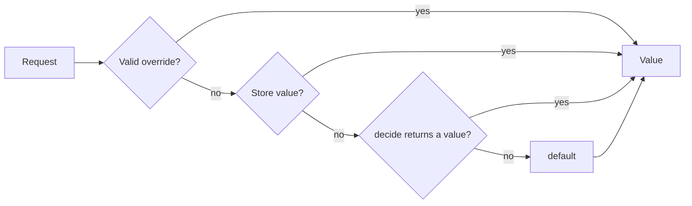

# Flargs Plan

Status: phases 1 to 6 done. Phase 7 is next.

Flargs is a self-hosted feature flag library for TypeScript and Rust. It declares flags in a committed `flags.json` or `flags.toml` file, evaluates them on the server, and serves a dev route and an admin API from the host application. This plan defines the public API, the phases, and the acceptance gate of each phase.

## Motivation

Trunk-based development merges small changes to `main` often. Unfinished work ships to production, disabled behind a flag, and the flag controls the release. Coding agents make the extra work of small steps (flags, parallel configurations, staged migrations) almost free, so a flag must be cheap to add, read, and remove.

- **Short-lived branches:** a change merges when it is safe to deploy, not when the feature is complete.
- **Release without deploy:** an admin enables a flag in the admin UI. No new build is necessary.
- **Personal preview:** a developer enables a flag for one browser through the dev route or a link, and other users see no change.
- **Self-hosted:** flags live in the host application and its database. No third-party service, account, or toolbar is necessary.

## Reference: Vercel Flags SDK

The Vercel Flags SDK (`flags` on npm) is the reference design. Sources: https://vercel.com/docs/flags, https://flags-sdk.dev, read 2026-10-30.

| Concept   | Vercel Flags SDK                                      | Flargs |
| --------- | ----------------------------------------------------- | ------ |
| `type`    | Value type                                            |
| ---       | ---                                                   |
| `boolean` | `boolean`                                             |
| `json`    | the type of `default`, such as `{ requests: number }` |
| `number`  | `number`                                              |
| `select`  | the union of `options`, such as `'a' \| 'b' \| 'c'`   |
| `string`  | `string`                                              |

Flargs keeps these Vercel Flags SDK decisions:

- **Typed declarations:** each flag has one declaration with a generated type. Find All References locates every read.
- **Server-first:** the server evaluates flags. A client receives values, not rules.
- **One default:** the flags file holds the default, so every caller falls back to the same value.

Flargs changes these Vercel Flags SDK decisions:

- **Store in place of provider:** the store holds values that an admin sets. A `Store` is a small interface, so a host database implements it directly.
- **Dev route in place of toolbar:** the host serves its own page to toggle flags. Nothing loads from a third party.
- **Build flags in place of precompute:** a `build` flag removes dead code from the bundle and never reaches the API. Precompute of runtime flags is out of scope until a phase needs it.

## Concepts

### Resolution Time

| Time      | Resolves                                         | Overrides                                    | Reaches the client                                                        |
| --------- | ------------------------------------------------ | -------------------------------------------- | ------------------------------------------------------------------------- |
| `build`   | when the bundle is built, from `env` and `store` | dev mode only, through the dev server        | as a literal in the bundle, or through `runtime.script`, only if `public` |
| `runtime` | on the server for each request                   | dev mode, public flags, and signed overrides | through `runtime.script` or `Values.load`, only if `public`               |

A build flag never appears in the values endpoint or in the admin API write path. A bundler replaces each read with a literal, so dead branches drop from the bundle.

### Visibility

- **`private` (default):** the value stays on the server. Only the authorized admin API returns it.
- **`public`:** the values endpoint, `runtime.script`, and the bundle can contain the value. An unsigned override from a search parameter applies in production.

### Resolution Order



- **Override:** from the `flargs` cookie or the request search parameters. Search parameters take precedence over the cookie.
- **Store value:** set through the admin API or the CLI. It applies to every request.
- **`decide`:** code on `Runtime.create`, keyed by flag, with the `identify` context. It returns `undefined` to fall through.
- **`default`:** required on every declaration.

An invalid override, store value, or `decide` result never selects a value. The server reports it through `onError` and continues with the next source. A stored value that a changed type or changed `options` invalidates therefore falls back to `decide`, then the default.

### Overrides

| Mode              | Private runtime flag | Public runtime flag | Build flag                       |
| ----------------- | -------------------- | ------------------- | -------------------------------- |
| Dev (`dev: true`) | unsigned             | unsigned            | unsigned, through the dev server |
| Production        | signed only          | unsigned or signed  | rejected                         |

Search parameter format:

```txt
https://app.example.com/checkout?flag.newCheckout=true&flag.pricing=b
https://app.example.com/checkout?flag.newCheckout=true&flag.exp=1767225600&flag.sig=3q2-7w
https://app.example.com/?flag.reset
```

- `flag.<key>=<value>` sets one override. Booleans are `true` and `false`. Select values are option values. JSON values are URL-encoded JSON.
- `flag.exp` is the expiry in seconds since the epoch. `flag.sig` is a base64url HMAC-SHA256 over the canonical override string: the sorted `key=value` pairs and `exp`, joined with `&`.
- `flag.reset` clears every override.
- The server copies valid overrides from search parameters to the signed `flargs` cookie, so the overrides persist across navigation. The cookie is `HttpOnly`, `SameSite=Lax`, and `Secure` outside dev mode.

## Definitions

A committed `flags.json` (TypeScript) or `flags.toml` (Rust) declares every flag with its default. Each flag links to one environment variable. A gitignored `.env`, `.env.local`, or the deploy environment sets the values that differ from the defaults.

```json
{
  "$schema": "./node_modules/flargs/schema.json",
  "limits": { "default": { "requests": 100 }, "type": "json" },
  "maintenanceBanner": { "build": true, "default": false, "public": true, "type": "boolean" },
  "newCheckout": {
    "default": false,
    "description": "Use the new checkout flow.",
    "public": true,
    "type": "boolean"
  },
  "pricing": { "default": "a", "options": ["a", "b", "c"], "type": "select" }
}
```

```toml
#:schema https://unpkg.com/flargs/schema.json
# flags.toml: the same flags for Rust. Keys are snake_case and map to camelCase.
[limits]
default = { requests = 100 }
type = "json"

[maintenance_banner]
build = true
default = false
public = true
type = "boolean"

[new_checkout]
default = false
description = "Use the new checkout flow."
public = true
type = "boolean"

[pricing]
default = "a"
options = ["a", "b", "c"]
type = "select"
```

```bash
# .env (gitignored): values for this device only.
FEATURE_NEW_CHECKOUT=true
FEATURE_PRICING=b
```

```ts
import { flags } from 'flargs'

// Typed from flags.json. Resolves from the environment, then the default.
flags.newCheckout // boolean
flags.pricing // 'a' | 'b' | 'c'
```

### Format

Both files follow one JSON Schema, published as `flargs/schema.json` and at a stable URL. The schema validates the files and completes keys in editors (JSON through `$schema`, TOML through Taplo).

Every flag is an object with an explicit `type` and `default`. Flargs infers no type and no default from a value.

| Field         | Meaning                                                                         | Default                                          |
| ------------- | ------------------------------------------------------------------------------- | ------------------------------------------------ |
| `build`       | `true` makes a build flag, which resolves when the bundle builds                | `false`                                          |
| `default`     | the default value. It must match `type`, and one of `options` for a select flag | required                                         |
| `description` | the description, for the dev route, the admin API, and `.env.example`           | none                                             |
| `env`         | the environment variable name                                                   | `FEATURE_` and the key in `SCREAMING_SNAKE_CASE` |
| `expires`     | a date (`YYYY-MM-DD`) after which the flag is due for retirement                | none                                             |
| `options`     | the values of a select flag                                                     | required for `select`                            |
| `public`      | `true` lets the value reach the browser                                         | `false`                                          |
| `type`        | `'boolean'`, `'json'`, `'number'`, `'select'`, or `'string'`                    | required                                         |

- **Environment variables:** `newCheckout` reads `FEATURE_NEW_CHECKOUT`. `env` sets another name. `envPrefix` on `Runtime.create`, `flargs/vite`, and `flargs::flags!` replaces `FEATURE_`.
- **Environment values:** `true` and `false` for booleans, digits for numbers, an option for selects, and JSON for JSON flags.
- **`.env.example`:** `flargs env` writes every variable with its default, and the description as a comment.
- **Visibility:** `public`, not a variable prefix, controls whether a value reaches the browser. A private flag never reaches a bundle, whatever its variable.
- **Validation:** a value outside `options`, or a value of the wrong type, throws at the first read. The error names the variable, and never contains the value.
- **Unknown variables:** a `FEATURE_*` variable that the flags file does not declare throws at startup, so a typo such as `FEATURE_NEW_CHEKOUT` does not fail silently. `flargs check` runs the same check in CI.
- **One file for two languages:** a project with a TypeScript app and a Rust service keeps one file. TypeScript reads `flags.toml`, and Rust reads `flags.json`, through the `path` option.
- **Library variables:** `FLARGS_SECRET`, `FLARGS_TOKEN`, and `FLARGS_URL` configure Flargs itself, so they use the `FLARGS_` prefix.

### Zero Config

With no flags file, Flargs declares a flag for each `FEATURE_*` variable in the environment. Each flag is private, and its type comes from its value. There are no options, no defaults, and no typo check. A flags file adds them later, with no change to reads of `flags`.

### Generated Module

`flargs generate` reads `flags.json` and writes `flargs.gen.ts`. `flargs/vite` writes the same file at startup and on each change of `flags.json`. A JSON import widens strings, so `'a' | 'b'` needs the generated module.

```ts
// flargs.gen.ts (generated, gitignored): the parsed definitions and their types.
export const definitions = {
  newCheckout: { default: false, env: 'FEATURE_NEW_CHECKOUT', public: true, type: 'boolean' },
  pricing: { default: 'a', env: 'FEATURE_PRICING', options: ['a', 'b', 'c'], type: 'select' },
} as const

declare module 'flargs' {
  interface Register {
    definitions: typeof definitions
  }
}
```

- **Runtime:** `Runtime.create` and `flargs/vite` take `definitions` from this module. No runtime reads the flags file from disk, so edge runtimes need no file system.
- **Types:** `flags`, `runtime.get`, `runtime.evaluate`, and `useFlag` read `Register`. `Register` is an `interface`, since declaration merging requires it.
- **Content mappers:** a TypeScript 7.1 content mapper can replace the generated module later. See [Out of Scope](#out-of-scope).

### Store Definitions

A project declares its flags in a flags file or in the store. With no `definitions`, `Runtime.create` reads the definitions from the store, so an admin UI creates flags with no deploy.

```ts
// No flags.json: the store holds the definitions and the values.
const runtime = Runtime.create({
  authorize,
  secret: process.env.FLARGS_SECRET,
  store: Store.from(database.flags),
})
```

```http
PUT /.flags/definitions/newCheckout

{ "default": false, "public": true, "type": "boolean" }
```

- **One source:** with `definitions`, the flags file is the only source of definitions, and the definition routes return `409`. Without `definitions`, the store is the only source.
- **Same schema:** a store definition follows the schema of a flag in `flags.json`, and the runtime validates it on write and on read.
- **Cache:** the runtime reads the definitions once, and again after each definition write through its own admin API. `Store.http` reads them from the remote admin API.
- **Store down:** if the store cannot return definitions, evaluation throws `Runtime.DefinitionsUnavailableError`. With no definitions, no default exists.
- **Types:** `flargs generate --url` writes `flargs.gen.ts` from the manifest of a running server.
- **Environment variables:** each store flag links to its `FEATURE_*` variable, as a file flag does.

|               | Flags file                                      | Store                                                                       |
| ------------- | ----------------------------------------------- | --------------------------------------------------------------------------- |
| Add a flag    | a reviewed change on `main`                     | an admin UI or `flargs define`, with no deploy                              |
| Defaults      | always available                                | available while the store is                                                |
| Types         | `flargs generate` from the file                 | `flargs generate --url` from a running server                               |
| Remove a flag | delete the key, and type errors show every read | `flargs undefine`, and stale reads fail at the next `flargs generate --url` |

### Growth

A project grows in three steps, with no change to the flags file or to reads of `flags`:

1. Environment variables, set for each deploy.
2. A `Runtime` with the dev route and personal overrides.
3. A shared store with an admin UI.

## Public API

### `flargs`

| Export                                      | Purpose                                                                                     |
| ------------------------------------------- | ------------------------------------------------------------------------------------------- |
| `Definitions.parse(input)`                  | validates a parsed `flags.json` or `flags.toml` against the schema, and returns definitions |
| `Definitions.fromEnv(env)`                  | infers definitions from `FEATURE_*` variables, for zero config                              |
| `Definitions.manifest(definitions)`         | returns the JSON manifest, the wire format of the admin API                                 |
| `Definitions.defines(definitions, options)` | returns `define` replacements for build flags, for any bundler                              |
| `Definitions.InvalidDeclarationError`       | thrown when a flag declaration is invalid. The error names the key                          |
| `Override.parse(input, options)`            | parses and verifies overrides from a `URL`, `URLSearchParams`, or cookie value              |
| `Override.serialize(values, options)`       | returns search parameters, signed when `secret` is set                                      |
| `Override.InvalidSignatureError`            | thrown when a signature does not match or has expired                                       |

### `flargs/server`

`Runtime.create` returns the runtime instance of the flags. It holds the store, the secret, and `identify`. It listens on no port. Its `fetch` property is a fetch handler, as in Hono and Cloudflare Workers.

```ts
import { Runtime, Store } from 'flargs/server'
import { definitions } from './flargs.gen.js'

// One instance per application instance.
export const runtime = Runtime.create({
  authorize: (request) => Admin.verify(request),
  decide: {
    // Return undefined to fall through to the default.
    pricing: (user) => (user?.plan === 'enterprise' ? 'c' : undefined),
  },
  definitions,
  dev: process.env.NODE_ENV === 'development',
  identify: (request) => Session.user(request),
  path: '/.flags',
  secret: process.env.FLARGS_SECRET,
  store: Store.memory(),
})

// Evaluate one flag. The instance caches the result for this request.
const newCheckout = await runtime.get(request, 'newCheckout')

// Serve the dev route and the admin API.
const response = await runtime.fetch(request)
```

| Export                                | Purpose                                                                               |
| ------------------------------------- | ------------------------------------------------------------------------------------- |
| `Runtime.create(options)`             | returns `{ evaluate, fetch, get, script }`                                            |
| `runtime.evaluate(request, options?)` | returns every runtime value. `options.visibility: 'public'` returns public flags only |
| `runtime.fetch(request)`              | serves the dev route and the admin API, and returns `404` outside `path`              |
| `runtime.get(request, key)`           | returns one typed value, and runs `decide` for that flag only                         |
| `runtime.script(request)`             | returns a `<script>` element with public values, escaped with `safeJson`              |
| `Store.memory()`                      | in-memory store, for dev and tests                                                    |
| `Store.http(options)`                 | reads and writes a remote Flargs admin API, such as a central admin service           |
| `Store.kv(namespace)`                 | Cloudflare KV store                                                                   |
| `Store.env(env)`                      | read-only store over `FEATURE_*` variables                                            |
| `Store.from(store)`                   | types a host store, such as a Postgres table                                          |

`get` and `evaluate` cache results per `Request` object in a `WeakMap` that the instance owns. Several reads in one request run `identify`, the store read, and each `decide` once.

`Store` contract:

```ts
// A host implements these three operations on its own database.
type Store = {
  delete: (key: string) => Promise<void>
  get: (keys: readonly string[]) => Promise<Record<string, unknown>>
  set: (key: string, value: unknown) => Promise<void>
  // Optional: lists every key with a value, so `flargs prune` finds orphan values.
  keys?: () => Promise<readonly string[]>
  // Required only for store definitions, when Runtime.create has no `definitions`.
  definitions?: {
    delete: (key: string) => Promise<void>
    list: () => Promise<Record<string, Definitions.Definition>>
    set: (key: string, definition: Definitions.Definition) => Promise<void>
  }
}
```

#### Store Schema

Flargs runs no database migrations. `Store.from` takes functions that the host writes against its own database, so the host owns the table and migrates it with its own tool, such as Drizzle, Prisma, or sqlx. The documentation publishes a reference schema for Postgres and SQLite.

```sql
-- Postgres. One row for each flag. `definition` is null when a flags file declares the flags.
create table flags (
  key        text primary key,
  definition jsonb,
  value      jsonb,
  updated_at timestamptz not null default now()
);
```

```sql
-- SQLite. JSON columns hold text.
create table flags (
  key        text primary key,
  definition text,
  value      text,
  updated_at text not null default (datetime('now'))
);
```

```ts
// Store.from maps the store operations to queries on the reference table.
const store = Store.from({
  delete: (key) => db.update(flags).set({ value: null }).where(eq(flags.key, key)),
  get: (keys) => db.select().from(flags).where(inArray(flags.key, keys)).then(toRecord),
  set: (key, value) =>
    db
      .insert(flags)
      .values({ key, value })
      .onConflictDoUpdate({ set: { value }, target: flags.key }),
})
```

#### Flag Changes

A change to a flag needs no database migration. Existing rows resolve as follows:

| Change                     | Stored row                    | Behavior                                                            |
| -------------------------- | ----------------------------- | ------------------------------------------------------------------- |
| Add a flag                 | none                          | resolves to `decide`, then the default, until a value is set        |
| Remove a flag              | an orphan value               | ignored by evaluation. `flargs retire` or `flargs prune` deletes it |
| Change `type` or `options` | a value that fails validation | reported through `onError`, then `decide`, then the default         |
| Rename a flag              | the row of the old key        | the new key has no value. The old row is an orphan                  |

`Runtime.create` options:

| Option        | Purpose                                                                                   | Default                                  |
| ------------- | ----------------------------------------------------------------------------------------- | ---------------------------------------- |
| `authorize`   | returns the access of an admin request: `'read'`, `'write'`, `undefined`, or a `Response` | `undefined` outside dev mode             |
| `decide`      | functions keyed by flag, which return a value from the `identify` context or `undefined`  | none                                     |
| `definitions` | `definitions` from `flargs.gen.ts`, or `Definitions.parse`                                | none, so the store holds the definitions |
| `dev`         | enables unsigned overrides for every flag and an open dev route                           | `false`                                  |
| `identify`    | returns the `decide` context for a request                                                | `undefined` context                      |
| `onError`     | receives invalid overrides, store values, and `decide` errors                             | none                                     |
| `path`        | the dev route and admin API path                                                          | `'/.flags'`                              |
| `secret`      | the HMAC secret for overrides and links                                                   | required outside dev mode                |
| `store`       | the store for admin values                                                                | none, so the store step is skipped       |
| `cors`        | `{ origins }` that receive CORS headers on the values endpoint                            | none                                     |
| `envPrefix`   | the prefix of flag environment variables                                                  | `'FEATURE_'`                             |

### Integrations

`runtime.fetch` mounts in every fetch-based runtime. Two entries cover the other cases.

```ts
// Cloudflare Workers and Bun: route the path to runtime.fetch.
export default {
  fetch: (request: Request) =>
    new URL(request.url).pathname.startsWith('/.flags')
      ? runtime.fetch(request)
      : app.fetch(request),
}
```

```ts
// Next.js: app/.flags/[...path]/route.ts
export const DELETE = runtime.fetch
export const GET = runtime.fetch
export const POST = runtime.fetch
export const PUT = runtime.fetch
```

```ts
// Hono: flargs/hono serves the path and sets c.var.flags for the request.
import { Hono } from 'hono'
import * as Flargs from 'flargs/hono'

const app = new Hono()
app.use(Flargs.middleware(runtime))

app.get('/checkout', async (c) => {
  // c.var.flags.get closes over c.req.raw.
  return (await c.var.flags.get('newCheckout')) ? newCheckout(c) : checkout(c)
})
```

```ts
// Node: flargs/node converts between node:http and the fetch API.
import * as Http from 'node:http'
import { Request } from 'flargs/node'

Http.createServer(Request.toNodeListener(runtime.fetch)).listen(3000)

// In an Express or node:http route, convert the request before a read.
const newCheckout = await runtime.get(Request.fromNodeListener(req, res), 'newCheckout')
```

| Entry         | Export                                      | Purpose                                                                                                                                                        |
| ------------- | ------------------------------------------- | -------------------------------------------------------------------------------------------------------------------------------------------------------------- |
| `flargs/hono` | `middleware(runtime)`                       | serves `path` through `runtime.fetch`, runs the next handler in `Values.run`, and sets `c.var.flags` with `evaluate`, `get`, and `script` bound to the request |
| `flargs/node` | `Request.toNodeListener(handler, options?)` | converts a fetch handler to a `node:http` request listener. With `options.runtime`, it runs the handler in `Values.run`                                        |
| `flargs/node` | `Request.fromNodeListener(req, res)`        | converts a `node:http` request to a fetch `Request`                                                                                                            |

The `flargs/node` names follow `Request.toNodeListener` in `wevm/mppx`. React Server Components in Next.js receive no `Request`. Support for `{ cookies, headers, url }` input waits for the Next.js guide.

### HTTP API

All routes live under `path`. The access column names the minimum return value of `authorize`, as defined in [Authorization](#authorization).

| Route                             | Access  | Response                                                                                             |
| --------------------------------- | ------- | ---------------------------------------------------------------------------------------------------- |
| `GET /.flags`                     | `read`  | the dev route page                                                                                   |
| `GET /.flags/manifest`            | `read`  | the manifest, with the store value and override of each flag                                         |
| `PUT /.flags/values/:key`         | `write` | sets the store value. Body: `{ "value": true }`                                                      |
| `DELETE /.flags/values/:key`      | `write` | deletes the store value                                                                              |
| `PUT /.flags/definitions/:key`    | `write` | creates or replaces a store definition. `409` with `definitions`                                     |
| `DELETE /.flags/definitions/:key` | `write` | deletes a store definition and its store value                                                       |
| `PUT /.flags/overrides`           | `read`  | sets the `flargs` cookie. Body: `{ "values": { "newCheckout": true } }`                              |
| `DELETE /.flags/overrides`        | `read`  | clears the `flargs` cookie                                                                           |
| `POST /.flags/links`              | `write` | returns a signed share URL. Body: `{ "expiresAt": 1767225600000, "url": "/checkout", "values": {} }` |
| `GET /.flags/values`              | none    | the public runtime values for the request                                                            |

Manifest response:

```json
{
  "flags": {
    "newCheckout": {
      "default": false,
      "description": "Use the new checkout flow.",
      "override": true,
      "resolve": "runtime",
      "store": null,
      "type": "boolean",
      "visibility": "public"
    }
  },
  "version": 1
}
```

### Authorization

`authorize(request)` is the only check on the admin API. The host supplies it and returns the access of the request. Flargs defines no credential format, and `FLARGS_SECRET` never authenticates a request.

| Return value | Access                                                   | Status of a rejected route        |
| ------------ | -------------------------------------------------------- | --------------------------------- |
| `'write'`    | every admin route                                        | none                              |
| `'read'`     | admin routes that change no store value and sign no link | `403` on a `write` route          |
| `undefined`  | the values endpoint only                                 | `401` on an admin route           |
| a `Response` | the values endpoint only                                 | this `Response` on an admin route |

- **Dev mode:** `dev: true` grants `write` to every request, and `authorize` does not run.
- **Default:** without `authorize`, every request outside dev mode receives `undefined`.
- **Errors:** if `authorize` throws, the request receives `undefined` and `onError` receives the error.
- **Public values:** `GET /.flags/values`, `runtime.get`, and `runtime.script` never call `authorize`.

Callers and credentials:

| Caller                                 | Credential                                                           | Access                                   |
| -------------------------------------- | -------------------------------------------------------------------- | ---------------------------------------- |
| Host admin UI, such as Tempo API Admin | the session cookie of the admin UI                                   | `write`                                  |
| CLI on a device (such as a laptop)     | a Handshakes access token from a device grant, in `FLARGS_TOKEN`     | `write`                                  |
| CI build                               | a Handshakes access token from a token exchange of the CI OIDC token | `read`                                   |
| `Store.http` in another application    | a Handshakes access token for that service                           | `read`, or `write` for a remote admin UI |

```ts
import { Resource } from 'handshakes/server'

// Verifies bearer tokens from the CLI, CI, and other services.
const resource = Resource.create({
  authorizationServers: ['https://auth.example.com'],
  resource: 'https://api.example.com',
})

const runtime = Runtime.create({
  async authorize(request) {
    // The admin UI session has full access.
    if (await Admin.verify(request)) return 'write'

    // The RFC 9728 challenge lets the Handshakes CLI discover the authorization server.
    const result = await resource.verify(request)
    if (result.status !== 'valid') return resource.challenge(result)

    if (result.principal.scopes.includes('flags:write')) return 'write'
    if (result.principal.scopes.includes('flags:read')) return 'read'
    return undefined
  },
  definitions,
  secret: process.env.FLARGS_SECRET,
  store,
})
```

A browser request from an admin UI on another origin needs CORS on the admin routes. Flargs sets no CORS headers. The host adds them, or the admin UI backend forwards the request.

### Dev Route

The dev route page lists every flag with its source (`override`, `store`, `decide`, or `default`), its value, and a control for each value.

- **Personal mode:** a control writes the `flargs` cookie through `PUT /.flags/overrides`. Only the current browser changes.
- **Admin mode:** when `store` is set and `authorize` returns `write`, a second control writes the store through `PUT /.flags/values/:key`. Every request changes.
- **Create:** with store definitions and `write` access, a form creates and deletes flags through the definition routes.
- **Share:** with `write` access, a button copies a signed link from `POST /.flags/links`.

The page is one HTML document with inline styles and script, no runtime dependency, and no external request. A host admin UI, such as Tempo API Admin, calls the same HTTP API.

### Values

`flargs` exports `flags`, the typed values of the current page or request. A read is synchronous and needs no `request` argument. Package export conditions select the source, with no bundler plugin.

```ts
import { flags } from 'flargs'

// The same read in browser code and in server code.
if (flags.newCheckout) newCheckout()
if (flags.maintenanceBanner) showBanner()
```

| Condition                        | Source of `flags`                                                                                 |
| -------------------------------- | ------------------------------------------------------------------------------------------------- |
| `browser`                        | the JSON script from `runtime.script`, parsed at the first read, or the response of `Values.load` |
| `node`, `bun`, `deno`, `workerd` | the values of the current request, stored by `Values.run` in `AsyncLocalStorage`                  |

| Export                             | Condition | Purpose                                                                                 |
| ---------------------------------- | --------- | --------------------------------------------------------------------------------------- |
| `flags`                            | all       | the typed values. A key that the page or request does not have reads as its `default`   |
| `Values.load(options?)`            | `browser` | requests `GET <url>/values`, and resolves when `flags` holds the response               |
| `Values.run(runtime, request, fn)` | server    | evaluates every runtime flag for `request`, then runs `fn` with those values in `flags` |
| `Values.subscribe(fn)`             | `browser` | calls `fn` after each `Values.load`, and returns an unsubscribe function                |

- **Page state:** in a browser, the page is the lifecycle of the values, so `flargs` keeps one snapshot for the page. This is the only module-scope state in Flargs.
- **Server state:** `flargs/hono` and `Request.toNodeListener` of `flargs/node` call `Values.run` for every request. Other fetch runtimes call it directly.
- **Eager evaluation:** `Values.run` runs every `decide`. A flag with an expensive `decide` uses `runtime.get(request, key)` in place of `flags`.
- **Build flags:** `runtime.script` and the values endpoint also contain public build flag values, so `flags` works with no bundler. `flargs/vite` replaces build flag reads with literals.
- **Private flags:** in a browser, a private flag reads as its `default`. With `flargs/vite`, a read of a private flag in browser code is a build error.

```ts
// Cloudflare Workers: every read of flags inside app.fetch uses this request.
export default {
  fetch: (request: Request) => Values.run(runtime, request, () => app.fetch(request)),
}
```

#### Separate Client

A client on another origin, such as a frontend for the Tempo API, has no embedded script. It loads the values from the API before the first read.

```ts
import { flags, Values } from 'flargs'

// Request the values from the API. Reads before this resolves return the defaults.
await Values.load({ url: 'https://api.example.com/.flags' })

flags.newCheckout
```

- **Overrides:** browsers block third-party cookies, so the API cannot store the `flargs` cookie for the client. `Values.load` copies `flag.*` parameters from `location` to `sessionStorage`, and sends them as search parameters on each request. Signed overrides keep their signature.
- **CORS:** `Runtime.create` takes `cors: { origins }`. The values endpoint returns CORS headers for those origins only. Admin routes never return CORS headers.
- **Types:** `flargs generate --url` writes `flargs.gen.ts` from the manifest of the API. See [CLI](#cli).

### Types

Types come from `flargs.gen.ts`, as described in [Generated Module](#generated-module).

| Declaration                          | Value type                               |
| ------------------------------------ | ---------------------------------------- |
| `false`                              | `boolean`                                |
| `3`                                  | `number`                                 |
| `["a", "b"]`                         | `'a' \| 'b'`                             |
| `{ "default": { "requests": 100 } }` | `{ requests: number }`, from the default |
| a string                             | `string`                                 |

Without a generated module, `flags` is `Readonly<Record<string, unknown>>`. A `decide` function on `Runtime.create` must return the type of its flag, or `undefined`. A `decide` key for a build flag is a type error.

### `flargs/react`

```tsx
import { useFlag } from 'flargs/react'

// Reads flags, and renders again after Values.load changes the values.
function Checkout() {
  const newCheckout = useFlag('newCheckout')
  return newCheckout ? <NewCheckout /> : <OldCheckout />
}
```

`useFlag` uses `useSyncExternalStore` over `flags` and `Values.subscribe`. It needs no provider.

### `flargs/vite`

```ts
import { defineConfig } from 'vite'
import flargs from 'flargs/vite'

export default defineConfig({
  // Reads flags.json, writes flargs.gen.ts, and replaces each build flag read with a literal.
  plugins: [flargs()],
})
```

- The plugin writes `flargs.gen.ts` at startup and on each change of `flags.json`.
- A build flag value resolves from its variable in the environment, then `store`, then the default in `flags.json`. `store` takes the same `Store` contract as `Runtime.create`, such as `Store.http`.
- The plugin replaces `flags.<key>` with a literal for every build flag, where `flags` is the import from `flargs`. Dead branches drop from the bundle.
- A read of a private flag in browser code is a build error.
- In dev mode, the dev route also lists build flags. A change writes an override file and triggers a full reload.
- `Definitions.defines(definitions, options)` returns `define` replacements for code that reads a global `flags` object. A bundler `define` does not replace a member of an imported binding, so code that imports `flags` uses the `flargs/zile` transform in a transform hook of the bundler.

### Retirement

A flag exists to merge unfinished work, so each flag has an end. Retirement replaces every read with the final value, then deletes the flag.

```json
{
  "newCheckout": { "default": false, "expires": "2027-01-31", "public": true, "type": "boolean" }
}
```

```bash
# Lists flags past their `expires` date.
flargs stale

# Replaces each read of newCheckout with true, deletes the declaration, and prunes the store.
flargs retire newCheckout --value true
```

- **Expiry:** after its `expires` date, a flag is stale. `flargs check` reports stale flags, and fails with `--strict`. The dev route marks them.
- **Final value:** `--value` sets the value that replaces every read. Without it, `flargs retire` uses the current store value, then the default, and prints the value it chose.
- **Code:** `flargs retire` rewrites TypeScript with the TypeScript compiler API. `flags.newCheckout` becomes `true`, a `useFlag('newCheckout')` call becomes `true`, and an `if` or a ternary with a literal condition keeps only the branch that runs. It prints each read it cannot rewrite, such as a dynamic key, with its file and line.
- **Declaration:** it deletes the key from `flags.json` (or `flags.toml`), or the store definition through `DELETE /.flags/definitions/:key`, and the store value through `DELETE /.flags/values/:key`.
- **Rust:** `flargs retire` deletes the key from `flags.toml`. `flargs::flags!` then fails to compile at every read of the removed key, which lists the reads to replace.
- **Agents:** the command is also an MCP tool through incur, so an agent retires a flag, then runs the type check and tests.
- **Dry run:** `--dry-run` prints the diff and changes nothing.

### Libraries

A library merges unfinished work to `main` behind a build flag, and publishes from `main` with the flag off. A library has no request, so it declares build flags only.

```json
{
  "$schema": "./node_modules/flargs/schema.json",
  "newEncoder": { "build": true, "default": false, "type": "boolean" }
}
```

```ts
import { flags } from 'flargs'

// Becomes `if (false)` in the published files. The consumer's bundler drops the branch.
if (flags.newEncoder) return encodeV2(value)
```

```jsonc
// package.json: zile replaces each build flag read after tsc.
"zile": { "transform": "flargs/zile" }
```

- **Zile:** zile transpiles with `tsc`. Its `transform` option (wevm/zile#52) names a module whose default export, `(code, file) => string`, rewrites each emitted `.js` file before zile writes it.
- **`flargs/zile`:** rewrites each read of a build flag to a literal with the TypeScript compiler API, since a bundler `define` cannot replace a member of an imported binding. Each value resolves from its variable in the environment of the build, then the default, so a CI job can publish a prerelease with `FEATURE_NEW_ENCODER=true`.
- **No runtime dependency:** the replacement removes the `flargs` import once every read is a literal, so `flargs` stays a dev dependency of the library. A runtime flag or a remaining `flargs` import fails the build.
- **Types:** `tsc` still emits the types of an unfinished export. Mark the export `@internal`, or keep it in an entry that the package does not publish.
- **Other builders:** tsup, tsdown, and Rollup call the `flargs/zile` transform from their own transform hook.

### CLI

The CLI uses incur, so `--llms`, `--mcp`, `--format`, and `skills add` are available on every command.

```bash
# Read the admin API of a running server. FLARGS_TOKEN holds the admin token.
flargs list --url https://api-admin.example.com/.flags
```

| Command                            | Purpose                                                                                                                    |
| ---------------------------------- | -------------------------------------------------------------------------------------------------------------------------- |
| `flargs list`                      | lists every flag with its value and source                                                                                 |
| `flargs get <key>`                 | returns one flag                                                                                                           |
| `flargs set <key> <value>`         | sets the store value                                                                                                       |
| `flargs unset <key>`               | deletes the store value                                                                                                    |
| `flargs define <key>`              | creates or replaces a store definition. `--type`, `--default`, `--options`, `--public`, and `--description` set its fields |
| `flargs undefine <key>`            | deletes a store definition                                                                                                 |
| `flargs prune`                     | lists stored values and definitions of undeclared keys. `--yes` deletes them                                               |
| `flargs retire <key>`              | replaces each read with the final value, deletes the declaration, and prunes the store. `--value` and `--dry-run`          |
| `flargs stale`                     | lists flags past `expires`                                                                                                 |
| `flargs link <url> <key=value...>` | returns a signed share URL. `--expires` sets the lifetime                                                                  |
| `flargs check`                     | validates the environment against the flags file, for CI                                                                   |
| `flargs env`                       | writes `.env.example` from the flags file                                                                                  |
| `flargs generate`                  | writes `flargs.gen.ts` from `flags.json`, or from `--url`                                                                  |
| `flargs dev`                       | serves the dev route for `flags.json`, for an application with no TypeScript server                                        |

Options: `--url` (default `FLARGS_URL`), and the admin token from `FLARGS_TOKEN`. The CLI never accepts a token in argv.

```bash
# In CI of a separate client. FLARGS_TOKEN holds a token with read access.
flargs generate --url https://api.example.com/.flags --out src/flargs.gen.ts
```

- `flargs generate --url` reads `GET /.flags/manifest` with `read` access, for a client in another repository.
- The output declares public flags only. `--visibility all` declares every flag, for server code.
- The output contains keys, types, options, and defaults. It contains no store value and no override.

### Rust

The `flargs` crate reads `flags.toml`. `flargs::flags!` parses it at compile time and generates a typed struct, so Rust needs no generated file.

```rust
// Reads flags.toml at compile time. A bad declaration fails the build at its line.
flargs::flags!("flags.toml");

// Generated: `Flags`, one typed key for each runtime flag, one const for each build flag,
// and `Pricing` (an enum with the variants A, B, and C) from `pricing = ["a", "b", "c"]`.
if Flags::MAINTENANCE_BANNER {
    banner();
}
```

```rust
// One runtime per process. The builder mirrors Runtime.create in TypeScript.
let runtime = flargs::Runtime::<Flags>::builder()
    .authorize(authorize)
    .decide(Flags::PRICING, |user: &User| (user.plan == Plan::Enterprise).then_some(Pricing::C))
    .identify(|parts| Session::user(parts))
    .secret(std::env::var("FLARGS_SECRET")?)
    .store(PgStore::new(pool))
    .build()?;

// Evaluate one flag. The runtime caches results for each request.
let new_checkout: bool = runtime.get(&parts, Flags::NEW_CHECKOUT).await?;
```

```rust
// axum: the tower::Service serves /.flags, and the extractor reads flags for the request.
let app = Router::new()
    .nest_service("/.flags", runtime.service())
    .route("/checkout", get(checkout))
    .layer(runtime.layer());

async fn checkout(flags: flargs::axum::Flags<Flags>) -> Result<Response, flargs::Error> {
    Ok(if flags.get(Flags::NEW_CHECKOUT).await? { new_checkout() } else { checkout_page() })
}
```

- **Build constants:** the macro reads each build flag variable with `option_env!`, then the default in `flags.toml`. `flargs::build::pull` in `build.rs` sets the variables from the admin API.
- **Request input:** each method takes `&http::request::Parts`, so every framework on the `http` crate can call it.
- **Access:** `authorize` returns `Access`, with the variants `None`, `Read`, `Response(http::Response<Body>)`, and `Write`, as in [Authorization](#authorization).
- **Store:** `Store` is a trait with `delete`, `get`, and `set`.

| Crate or feature     | Contents                                                                                 |
| -------------------- | ---------------------------------------------------------------------------------------- |
| `flargs` (default)   | `Key`, `overrides::parse`, `overrides::serialize`, `Runtime`, `Store`, and `MemoryStore` |
| `flargs-definitions` | the flags file parser, shared by `flargs` (as `flargs::definitions`) and `flargs-macros` |
| `flargs-macros`      | `flargs::flags!`, re-exported by the `macros` feature (on by default)                    |
| `axum` feature       | the `flargs::axum::Flags` extractor                                                      |
| `build` feature      | `flargs::build::pull`                                                                    |
| `client` feature     | `HttpStore` and `Client`, for the admin API and the values endpoint                      |
| `server` feature     | `Runtime::service` and `Runtime::layer`, a `tower::Service` and a `tower::Layer`         |

## Phases

Each phase ends with its gate. A later phase starts only after the gate of the previous phase passes.

### Phase 0: Scaffold

- Package with zile, Vite Plus, the `catalog:` workspace, `tsconfig.json` paths, and test aliases.
- Entries: `flargs` and `flargs/server`.
- **Gate:** `pnpm check`, `pnpm check:types`, `pnpm test`, and `pnpm build` pass on an empty entry. Done in `65f286a`.

### Phase 1: Definitions and Overrides

- `Definitions.parse`, `Definitions.fromEnv`, `Definitions.manifest`, `flargs/schema.json`, and `flargs.gen.ts` output.
- `Override.parse` and `Override.serialize`, with signatures and expiry.
- Vectors: `test/vectors/definitions.json` (flags files and their parsed result) and `test/vectors/overrides.json`.
- **Gate:** vectors cover every type, a missing `type` or `default`, a `default` outside `options`, `options`, `public`, `build`, `env`, invalid declarations, the same flags in JSON and TOML, unknown and invalid variables, and expired and wrong signatures. Type tests prove the types of a generated module.

### Phase 2: Server

- `Runtime.create`, `evaluate`, `fetch`, `get`, `script`, and `Store.memory`.
- `flargs/node` and `flargs/hono`.
- The HTTP API and the resolution order.
- **Gate:** integration tests over a local HTTP server cover each resolution source, each override mode, each `authorize` return value on each route, and the absence of private values in public responses. Vectors: `test/vectors/evaluate.json`.

### Phase 3: Dev Route

- The dev route page, in personal mode, admin mode, and share links.
- **Gate:** browser tests toggle a flag, reload, and assert the new value. A production request without access receives `401`, and a `read` request that writes receives `403`.

### Phase 4: Values and React

- `flags` and `Values` in every condition of `flargs`, `Values.run` in `flargs/hono` and `flargs/node`, and `flargs/react`.
- **Gate:** browser tests read embedded values with no request, and `Values.load` from another origin with CORS and a stored override. Server tests read `flags` inside `Values.run` in Node and in `wrangler dev`, with two concurrent requests that resolve different values.

### Phase 5: Build Flags

- `flargs/vite`, `flargs/zile`, and `Definitions.defines`. The `transform` option of zile lands in `wevm/zile` first (wevm/zile#52).
- **Gate:** a Vite build of a fixture app contains the literal, drops the dead branch, and contains no private build flag key. A zile build of a fixture library contains the literal and no `flargs` import.

### Phase 6: CLI

- `list`, `get`, `set`, `unset`, `define`, `undefine`, `prune`, `retire`, `stale`, `link`, `check`, `env`, `generate`, and `dev`.
- **Gate:** the built CLI runs against a local `runtime.fetch`. No output contains `FLARGS_TOKEN` or `FLARGS_SECRET`. A `.test-d.ts` fixture type-checks against the output of `flargs generate`. `flargs retire` on a fixture app rewrites every read, removes dead branches, and leaves a project that passes `tsc`.

### Phase 7: Stores

- `Store.env`, `Store.http`, `Store.kv`, and `Store.from`, and store definitions.
- **Gate:** one `Runtime.create` instance uses `Store.http` to write through a second instance, and a value set on the second applies to the first. A flag defined through the admin API resolves with no flags file, and a definition route returns `409` when `definitions` is set.

### Phase 8: Rust

- `crates/flargs` and `crates/flargs-macros`, with the `axum`, `build`, `client`, `macros`, and `server` features.
- **Gate:** the crate passes every vector. Its `HttpStore` and `Client` run against the TypeScript `runtime.fetch`. `trybuild` fixtures reject an invalid `flags.toml` declaration and a `decide` for a build flag.

### Phase 9: Documentation

- Vocs site: Introduction (with the trunk-based development motivation), guides for Hono, Next.js, Cloudflare Workers, Vite, and Rust, the API reference, and the CLI reference.
- **Gate:** `pnpm docs:build` passes with no dead link.

## Out of Scope

- **Percentage rollouts and targeting rules:** `decide` covers them in code. A rule engine in the store waits for three concrete uses.
- **Precompute of runtime flags:** encodes values into the URL for static pages. Add it when a static page needs a runtime flag.
- **Vercel Toolbar compatibility:** a `/.well-known/vercel/flags` adapter. Add it when a host uses the Toolbar.
- **Audit log and history:** a host store can record writes. Add an API when two hosts need the same shape.
- **Database adapters:** `Store.postgres` or `Store.drizzle`, with Flargs-owned tables and migrations. Add one when three projects need the same adapter. Until then, `Store.from` and the reference schema cover each database.
- **Real-time updates:** the client refreshes on request. Add a stream when a page must change without a reload.
- **Content mapper:** a TypeScript 7.1 content mapper (`flargs/content-mapper`) that types the flags file with no generated module. Mappers match files by extension, and TypeScript handles `.json` itself, so a mapper cannot claim `flags.json`. Add it when mappers match a compound extension such as `.flags.json`. Type checks with a mapper also need `tsc --runExternalCode`, and VS Code needs workspace trust and mapper permission.

## Open Questions

- **Search parameter prefix:** `flag.<key>`, or one `flags=key:value,key:value` parameter.
- **Rust value struct:** `evaluate` returns `Flags`, or a separate generated struct for public values only.
- **Scope names:** `flags:read` and `flags:write`, or one scope for each application in a shared store.
