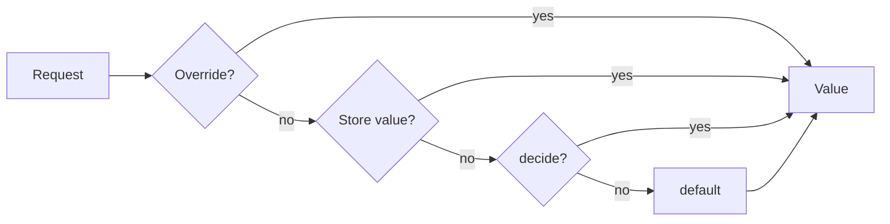

<h1 align="center">Flargs</h1>

<p align="center">
  Self-hosted feature flags for TypeScript and Rust
</p>

<p align="center">
  <a href="#overview">Overview</a> · <a href="#motivation">Motivation</a> · <a href="#philosophy">Philosophy</a> · <a href="#features">Features</a> · <a href="#usage">Usage</a> · <a href="#cli">CLI</a> · <a href="#rust">Rust</a>
</p>

> [!NOTE]
> Flargs is in development. [`.agent/plans/flargs.md`](.agent/plans/flargs.md) defines the API and the phases. The examples below describe the planned API and do not work yet.

## Overview

```ts
import { f, Flags } from 'flargs'

// Declares every flag in one record. The default applies when no other source has a value.
export const definitions = Flags.define({
  newCheckout: f.boolean({ default: false, visibility: 'public' }),
  pricing: f.select({ default: 'a', options: ['a', 'b', 'c'] }),
})
```

```bash
# Sets a flag for one deploy, with no server and no store.
FEATURE_NEW_CHECKOUT=true
```

```ts
import { flags } from 'flargs/values'

// Typed from the definitions. Resolves on the server, or from the page in a browser.
if (flags.newCheckout) renderNewCheckout()
```

The same definitions and reads scale from environment variables to a dev route, personal overrides, and an admin API on the database of the application.



## Motivation

Trunk-based development merges small changes to `main` often. Unfinished work ships to production behind a flag, and the flag, not the branch, controls the release.

- **Short-lived branches:** A change merges when it is safe to deploy, not when the feature is complete.
- **Release without a deploy:** An admin enables a flag in an admin UI. No new build is necessary.
- **Personal preview:** A developer enables a flag for one browser, through the dev route or a link. Other users see no change.
- **Self-hosted:** Flags live in the application and its database. No third-party service, account, or toolbar is necessary.

The [Vercel Flags SDK](https://flags-sdk.dev) established flags as code. Flargs keeps that model and replaces the hosted parts: a store in place of a provider, a dev route in place of a toolbar, and build flags in place of precompute.

## Philosophy

- **Flags as code:** Each flag is a typed declaration with one default. Find All References locates every use.
- **Server-first:** The server resolves flags. A browser receives values, never rules.
- **Private by default:** A private value never leaves the server. Visibility, not a variable prefix, controls what reaches a browser.
- **Incremental:** Environment variables, a dev route, and an admin API use the same definitions and the same reads.
- **Portable:** The core, server, and browser entries have no dependencies. They run in Node, Bun, Deno, edge runtimes, and browsers.
- **Tested:** Every test runs against a real server, browser, or build, with no mocks.

## Features

- **Declarations:** `f.boolean`, `f.select`, and `f.json`, with types inferred from the definitions.
- **Environment Variables:** `FEATURE_NEW_CHECKOUT=true` sets a flag with no server.
- **Build Flags:** Compile to literals, so dead branches drop from the bundle and the value never reaches an API.
- **Runtime Flags:** Resolve on the server for each request, from an override, a store value, `decide`, or the default.
- **Dev Route:** A page at `/.flags` toggles flags for one browser, or for every request with admin access.
- **Admin API:** Reads and writes store values over HTTP, for an admin UI, the CLI, or CI.
- **Overrides:** Search parameters such as `?flag.newCheckout=true` override public flags. Signed links override private flags.
- **Stores:** Memory, environment variables, Cloudflare KV, a remote Flargs API, or a table in the database of the application.
- **Integrations:** A fetch handler for Next.js, Cloudflare Workers, and Bun, plus Hono middleware, Node listeners, React, and Vite.
- **CLI and MCP:** Lists, sets, and links flags, and generates types for a client in another repository.
- **Rust:** `#[derive(Flags)]` with the same manifest, overrides, and signatures as TypeScript.

## Usage

### Definitions

```ts
import { f, Flags } from 'flargs'

export const definitions = Flags.define({
  // Resolves when the bundle builds. The value is a literal in the bundle.
  maintenanceBanner: f.boolean({ default: false, resolve: 'build', visibility: 'public' }),

  // Resolves on the server for each request.
  newCheckout: f.boolean({ default: false, visibility: 'public' }),

  // Private: the value never leaves the server.
  pricing: f.select({
    decide: (context) => (context.user?.plan === 'enterprise' ? 'c' : undefined),
    default: 'a',
    options: ['a', 'b', 'c'],
  }),
})

// Registers the definitions once, so every read is typed.
declare module 'flargs' {
  interface Register {
    definitions: typeof definitions
  }
}
```

| Option | Purpose | Default |
| --- | --- | --- |
| `decide` | returns a value from the request context, or `undefined` to fall through | none |
| `default` | the value when no other source has one | required |
| `env` | the environment variable name | `FEATURE_` and the key in `SCREAMING_SNAKE_CASE` |
| `resolve` | `'build'` or `'runtime'` | `'runtime'` |
| `visibility` | `'private'` or `'public'` | `'private'` |

### Environment Variables

A flag reads `FEATURE_` followed by its key in `SCREAMING_SNAKE_CASE`. Flargs reads only the variables of declared flags.

```bash
# Boolean, select, and JSON values.
FEATURE_NEW_CHECKOUT=true
FEATURE_PRICING=b
FEATURE_LIMITS={"requests":100}
```

Outside a request, `flags` resolves each flag from its variable, then its default. Flargs configuration uses a separate prefix: `FLARGS_SECRET`, `FLARGS_TOKEN`, and `FLARGS_URL`.

### Runtime

`Runtime.create` adds overrides, a store, `decide`, the dev route, and the admin API. `runtime.fetch` is a fetch handler.

```ts
import { Runtime, Store } from 'flargs/server'

export const runtime = Runtime.create({
  authorize: (request) => Admin.access(request),
  definitions,
  dev: process.env.NODE_ENV === 'development',
  identify: (request) => Session.user(request),
  secret: process.env.FLARGS_SECRET,
  store: Store.from(database.flags),
})

// Evaluates one flag for one request.
const pricing = await runtime.get(request, 'pricing')

// Serves the dev route and the admin API under /.flags.
const response = await runtime.fetch(request)
```

```ts
// Hono: serves /.flags and resolves `flags` for each request.
import * as Flargs from 'flargs/hono'

app.use(Flargs.middleware(runtime))
```

```ts
// Node: converts the fetch handler to a request listener.
import * as Http from 'node:http'
import { Request } from 'flargs/node'

Http.createServer(Request.toNodeListener(runtime.fetch, { runtime })).listen(3000)
```

### Values

`flargs/values` exports `flags`. A read is synchronous and takes no request argument.

```ts
import { flags } from 'flargs/values'

// On the server: the values of the current request. In a browser: the public values of the page.
if (flags.newCheckout) renderNewCheckout()
```

| Where | Source of `flags` |
| --- | --- |
| Server | the current request, through Hono middleware, a Node listener, or `Values.run` |
| Browser | the JSON script from `runtime.script`, or `Values.load` for a client on another origin |
| No runtime | environment variables, then defaults |

```tsx
// React: renders again when the values change. No provider is necessary.
import { useFlag } from 'flargs/react'

const newCheckout = useFlag('newCheckout')
```

### Build Flags

`flargs/vite` replaces each read of a build flag with a literal. A read of a private flag in browser code is a build error.

```ts
import { defineConfig } from 'vite'
import flargs from 'flargs/vite'
import { definitions } from './src/flags.js'

export default defineConfig({
  // Resolves build flags from FEATURE_* variables, then the store, then defaults.
  plugins: [flargs({ definitions })],
})
```

### Overrides

| Mode | Private runtime flag | Public runtime flag | Build flag |
| --- | --- | --- | --- |
| Dev | unsigned | unsigned | unsigned, through the dev server |
| Production | signed only | unsigned or signed | rejected |

```txt
https://app.example.com/checkout?flag.newCheckout=true
https://app.example.com/checkout?flag.pricing=c&flag.exp=1767225600&flag.sig=3q2-7w
https://app.example.com/?flag.reset
```

The server stores valid overrides in a signed `HttpOnly` cookie, so they persist across navigation.

### Admin API

The admin API lives under `/.flags`. `authorize` returns the access of each request, and Flargs defines no credential format.

| Route | Access | Purpose |
| --- | --- | --- |
| `GET /.flags` | `read` | the dev route page |
| `GET /.flags/manifest` | `read` | definitions, store values, and overrides |
| `PUT /.flags/values/:key` | `write` | sets a store value for every request |
| `DELETE /.flags/values/:key` | `write` | deletes a store value |
| `PUT /.flags/overrides` | `read` | sets personal overrides |
| `POST /.flags/links` | `write` | returns a signed share link |
| `GET /.flags/values` | none | public values for the request |

```ts
// The admin UI session writes. CI tokens from Handshakes read.
authorize: async (request) => {
  if (await Admin.verify(request)) return 'write'

  const result = await resource.verify(request)
  if (result.status !== 'valid') return resource.challenge(result)

  return result.principal.scopes.includes('flags:write') ? 'write' : 'read'
},
```

## CLI

The CLI uses [incur](https://github.com/wevm/incur), so every command supports `--llms`, `--mcp`, and `--format`.

```bash
# Lists every flag of a running server. FLARGS_TOKEN holds the token.
flargs list --url https://api.example.com/.flags

# Sets a store value for every request.
flargs set newCheckout true

# Returns a signed link that overrides a private flag for one week.
flargs link https://app.example.com/checkout pricing=c --expires 7d

# Writes types for a client in another repository.
flargs types --url https://api.example.com/.flags --out src/flargs.d.ts
```

| Command | Purpose |
| --- | --- |
| `flargs list` | lists every flag with its value and source |
| `flargs get <key>` | returns one flag |
| `flargs set <key> <value>` | sets the store value |
| `flargs unset <key>` | deletes the store value |
| `flargs link <url> <key=value...>` | returns a signed share link |
| `flargs manifest <file>` | writes the manifest of a definitions module |
| `flargs types` | writes a `.d.ts` file with the `Register` declaration |
| `flargs dev` | serves the dev route for a manifest |

## Rust

```rust
use flargs::{Flags, Options};

/// Flags of the checkout service.
#[derive(Flags)]
#[flags(context = User)]
pub struct AppFlags {
    /// Use the new checkout flow. Reads FEATURE_NEW_CHECKOUT.
    #[flag(default = false, public)]
    pub new_checkout: bool,

    /// Pricing page variant.
    #[flag(decide = decide_pricing, default = Pricing::A)]
    pub pricing: Pricing,
}

#[derive(Clone, Copy, Options)]
pub enum Pricing {
    A,
    B,
    C,
}
```

```rust
// axum: serves /.flags, and evaluates flags for each request.
let app = Router::new()
    .nest_service("/.flags", runtime.service())
    .route("/checkout", get(checkout))
    .layer(runtime.layer());
```

The crate reads the same manifest, overrides, and signatures as TypeScript. `#[flags(manifest = "../web/flags.json")]` fails to compile when the struct differs from the TypeScript definitions.

## License

[MIT](LICENSE) License
