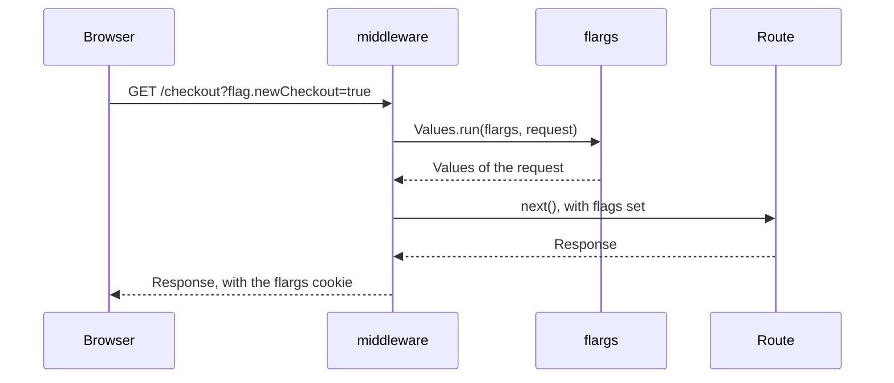

# Hono [Serves the dev route and scopes flags to each request with one middleware]

## Overview

`flargs/hono` exports `middleware`. It serves the flags path through `flargs.fetch`, and runs every other request in `Values.run`, so `flags` holds the values of that request. It also sets `c.var.flags` with operations that close over the request.



## Walkthrough

### Create the Instance

```ts [flags.ts]
import { Flargs } from 'flargs/server'
import { definitions } from './flargs.gen.js'

// One instance for each application instance.
export const flargs = Flargs.create({
  definitions,
  dev: process.env.NODE_ENV === 'development',
  secret: process.env.FLARGS_SECRET,
})
```

### Add the Middleware

`Env` types `c.var.flags` for the instance.

```ts [app.ts]
import { flags } from 'flargs'
import { type Env, middleware } from 'flargs/hono'
import { Hono } from 'hono'
import { flargs } from './flags.js'

const app = new Hono<Env<typeof flargs>>()

// Serves /.flags, and runs each other request in Values.run.
app.use(middleware(flargs))

app.get('/checkout', (c) => c.text(flags.newCheckout ? 'New checkout' : 'Checkout'))

export default app
```

### Read One Flag

`Values.run` evaluates every runtime flag, so it runs every `decide`. A route with an expensive `decide` reads one flag through `c.var.flags.get`, which runs `decide` for that flag only.

```ts [app.ts]
// Runs decide for pricing only. The instance caches the result for the request.
app.get('/pricing', async (c) => c.json({ pricing: await c.var.flags.get('pricing') }))
```

## Recipes

### Embed the Values

`c.var.flags.script()` returns a `<script>` element with the public values. In a browser, `flags` reads the values from this element.

```ts [app.ts]
app.get('/', async (c) => {
  // Public values only, escaped so a value cannot close the element.
  const script = await c.var.flags.script()
  return c.html(`<!doctype html><html><head>${script}</head><body></body></html>`)
})
```

### Overrides

A `flag.*` search parameter overrides a value for the request. The middleware then appends a `Set-Cookie` header with the `flargs` cookie, so the override persists across navigation. `?flag.reset` clears every override.

```sh
# Overrides a public flag in production. A private flag needs a signed link.
curl -i 'https://app.example.com/checkout?flag.newCheckout=true'
```

### Admin Access

Outside dev mode, the dev route and the admin API need `authorize`. [Admin API](/guides/admin-api) describes it.

## More

- **Function:** [`middleware`](/api/hono) lists the types and the behavior.
- **Runtime:** [`Flargs.create`](/api/server/flargs/create) lists every option.
- **Browser:** [React](/guides/react) reads the embedded values with `useFlag`.
