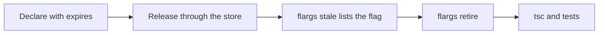

# Retirement [Replaces every read of a flag with its final value, then deletes the flag]

## Overview

A flag exists to merge unfinished work, so each flag has an end. The `expires` field marks the date after which a flag is due. `flargs retire` replaces each read with the final value, removes the dead branch, and deletes the declaration.



## Walkthrough

### Set an Expiry

```json [flags.json]
{
  "newCheckout": { "default": false, "expires": "2027-01-31", "public": true, "type": "boolean" }
}
```

A flag is stale from the day after its `expires` date, in UTC. The dev route marks a stale flag, and the manifest sets `stale: true`.

### List Stale Flags

```sh
# Lists flags past their expires date
npx flargs stale
```

```json
{ "stale": [{ "expires": "2027-01-31", "key": "newCheckout" }] }
```

`flargs check` also reports stale flags. With `--strict`, a stale flag fails the check, so CI enforces the expiry.

### Retire the Flag

```sh
# Replaces each read of newCheckout with true, and deletes its declaration
npx flargs retire newCheckout --value true
```

Before:

```ts [src/checkout.ts]
import { flags } from 'flargs'

export function checkout(): string {
  // A read of the flag in an if statement
  if (flags.newCheckout) {
    return 'new'
  } else {
    return 'old'
  }
}
```

After:

```ts [src/checkout.ts]
// The import and the dead branch are removed.
export function checkout(): string {
  return 'new'
}
```

## Recipes

### Final Value

`--value` sets the value that replaces every read. Without it, the command uses the store value of the server at `--url`, then the default. The output holds the value that the command used.

```sh
# Uses the store value of the running server as the final value
FLARGS_TOKEN=... npx flargs retire newCheckout --url https://api.example.com/.flags
```

With `--url`, the command also deletes the store value. A failure of this request does not fail the command.

### Dry Run

`--dry-run` writes nothing. The output lists the files that the command would change.

```sh
# Lists the files that contain a read of newCheckout
npx flargs retire newCheckout --dry-run
```

### Rewrites

- **Reads:** `flags.newCheckout`, `flags['newCheckout']`, and `useFlag('newCheckout')` become the literal value.
- **Branches:** an `if` statement or a conditional expression with a literal condition keeps only the branch that runs.
- **Imports:** the `flags` and `useFlag` imports are removed when no read remains.
- **Dynamic reads:** a read with a computed key stays. The `unresolved` field lists its file and line.
- **Files:** the files that git tracks or does not ignore, with a JavaScript or TypeScript extension. Declaration files and `flargs.gen.ts` are skipped.

The command deletes the key from `flags.json`, and writes `flargs.gen.ts` again if it exists. The type check and the tests run after it.

### Store Definitions

`flargs retire` reads the declaration from `flags.json`. A flag that the store declares is removed with [`flargs undefine`](/cli/undefine) after a manual rewrite of its reads.

### Orphan Values

A store value of a deleted flag stays in the store. [`flargs prune`](/cli/prune) lists these orphan values, and deletes them with `--yes`.

## More

- **Command:** [`retire`](/cli/retire) lists every option and the output.
- **Commands:** [`stale`](/cli/stale) and [`check`](/cli/check).
- **Rust:** [Rust](/guides/rust) describes the compile errors after a key is removed.
