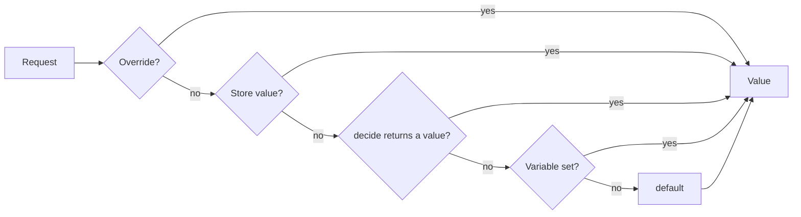

# Concepts [Build and runtime flags, visibility, the resolution order, overrides, and stores]

## Terms

| Term         | Meaning                                                                               |
| ------------ | ------------------------------------------------------------------------------------- |
| Flags file   | `flags.json` or `flags.toml`, which declares every flag with its type and its default |
| Definition   | One validated declaration, as `Definitions.parse` returns it                          |
| Instance     | The object that `Flargs.create` returns. It evaluates flags and serves `flargs.fetch` |
| Override     | A value for one browser, from a `flag.*` search parameter or the `flargs` cookie      |
| Store value  | A value that the admin API writes to the store. It applies to every request           |
| `decide`     | A function of the host for one flag, which returns a value from the request context   |
| Dev route    | The page at `/.flags`, which toggles overrides and store values                       |
| Build flag   | A flag with `build: true`, which resolves when the bundle builds                      |
| Runtime flag | A flag without `build: true`, which resolves on the server for each request           |

## Resolution Time

A flag resolves at one of two times.

| Time      | Resolves                                                              | Reaches the client                                               |
| --------- | --------------------------------------------------------------------- | ---------------------------------------------------------------- |
| `build`   | when the bundle builds, from a store, the environment, or the default | as a literal in the bundle, or through `flargs.script` if public |
| `runtime` | on the server for each request                                        | through `flargs.script` or `Values.load`, if public              |

A build flag accepts no `decide`, and accepts an override only in dev mode. [`flargs/vite`](/guides/vite) and [`flargs/zile`](/guides/libraries) replace each read of a build flag with a literal, so dead branches drop from the bundle. Without a bundler plugin, the instance evaluates a build flag like a runtime flag without `decide`.

## Visibility

- **Private (default):** the value stays on the server. Only the admin API returns it, to a request that `authorize` grants `read` or `write`.
- **Public (`"public": true`):** the values endpoint and `flargs.script` contain the value. An unsigned override applies in production.

In a browser, a private flag has no value, so its read returns `undefined`. With `flargs/vite`, a read of a private runtime flag in browser code fails the build.

## Resolution Order

The instance resolves a value in one order. Each step runs only when the step before it has no valid value.



- **Override:** from the `flargs` cookie, then the `flag.*` search parameters of the request. Search parameters take precedence.
- **Store value:** written through the admin API or the CLI.
- **`decide`:** called with the context that `identify` returns. It returns `undefined` to fall through. A build flag skips this step.
- **Variable:** the environment variable of the flag, such as `FEATURE_NEW_CHECKOUT`.
- **Default:** required on every declaration.

An invalid store value, `decide` result, or variable never selects a value. The instance passes the error to `onError` and continues with the next step. The `source` field of the [manifest](/guides/admin-api) names the step that selected each value: `override`, `store`, `decide`, `env`, or `default`.

## Overrides

An override sets a value for one browser. The search parameter `flag.<key>=<value>` sets one override, and `flag.reset` clears every override.

| Mode              | Private runtime flag | Public runtime flag | Build flag |
| ----------------- | -------------------- | ------------------- | ---------- |
| Dev (`dev: true`) | unsigned             | unsigned            | unsigned   |
| Production        | signed only          | unsigned or signed  | rejected   |

```txt
https://app.example.com/checkout?flag.newCheckout=true
https://app.example.com/checkout?flag.pricing=c&flag.exp=1767225600&flag.sig=3q2-7w
https://app.example.com/?flag.reset
```

- **Signature:** `flag.sig` is a base64url HMAC-SHA256 over the sorted `key=value` pairs and `exp=<seconds>`, joined with `&`. `flag.exp` is the expiry in seconds since the epoch.
- **Cookie:** the integrations copy valid overrides from the search parameters to the `flargs` cookie, so they persist across navigation. The cookie is signed, `HttpOnly`, `SameSite=Lax`, and `Secure` outside dev mode. It expires after 30 days.
- **Rejection:** an unknown key, an invalid value, or a flag that does not accept the override is dropped and passed to `onError`.

[`flargs link`](/cli/link) and `POST /.flags/links` return a signed link.

## Stores

A store holds the values that the admin API writes. Some stores also hold definitions, for a project with no flags file.

| Store                                      | Values                 | Definitions | Use                                      |
| ------------------------------------------ | ---------------------- | ----------- | ---------------------------------------- |
| [`Store.memory`](/api/server/store/memory) | read, write            | yes         | dev mode and tests                       |
| [`Store.env`](/api/server/store/env)       | read only              | no          | values from `FEATURE_*` variables        |
| [`Store.http`](/api/server/store/http)     | read, write            | yes         | the admin API of another Flargs instance |
| [`Store.kv`](/api/server/store/kv)         | read, write            | yes         | a Cloudflare KV namespace                |
| [`Store.from`](/api/server/store/from)     | as the host implements | optional    | a table in the database of the host      |

[Store Definitions](/guides/store-definitions) describes a store that holds the definitions.
